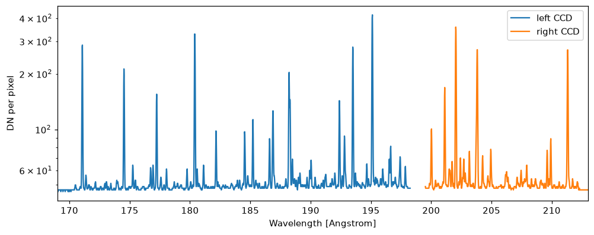

# Analysing a full-CCD frame

<div class="glance" markdown>
<div markdown>
**You need**

A [full-CCD frame](../observe/full-ccd-frames.md)
</div>
<div markdown>
**You run**

Python
</div>
<div markdown>
**You get**

The spectrum of the whole band, as the camera records it
</div>
</div>

`dn` holds the frame as it is read out, with the prescan and overscan of each output, and `rate` holds the photons reaching each pixel. A [frame file](../files/frame.md) keeps both.

## What a frame holds

For each CCD, `"left"` and `"right"`:

- `rate`: photons per second reaching each image pixel
- `photons`: photons in each pixel over the exposure
- `dn`: the frame as read out, in DN, with the prescan and overscan of each output
- `wavelength`: the wavelength each row records
- `field_angle`: each column's angle along the slit, positive towards solar north
- `photon_wavelength`, `photon_rms_wavelength`: the wavelengths of the mean and root mean square energies of each pixel's photons

Each CCD's columns count from its left output: from the north end of the slit on the left CCD, and the south end on the right. `settings["spectra"]` names the entries of the synthesis file the frame holds.

## The spectrum of the band

The median of the image columns in each row gives the spectrum of the whole band:

```python
import matplotlib.pyplot as plt

if __name__ == "__main__":
    pre, over = frame.settings["serial_prescan"], frame.settings["serial_overscan"]
    fig, ax = plt.subplots(figsize=(9, 3.5), layout="constrained")
    for ccd in ("left", "right"):
        rows = frame.wavelength[ccd].to_value(u.AA)
        half = frame.rate[ccd].shape[1] // 2
        columns = np.r_[pre:pre + half, pre + half + 2 * over:pre + 2 * half + 2 * over]
        order = np.argsort(rows)
        spectrum = np.median(frame.dn[ccd][:rows.size, columns], axis=1)
        ax.plot(rows[order], spectrum[order], label=f"{ccd} CCD")
    ax.set_xlim(169, 213)
    ax.set_yscale("log")
    ax.set_xlabel("Wavelength [Angstrom]")
    ax.set_ylabel("DN per pixel")
    ax.legend()
    plt.show()
```


