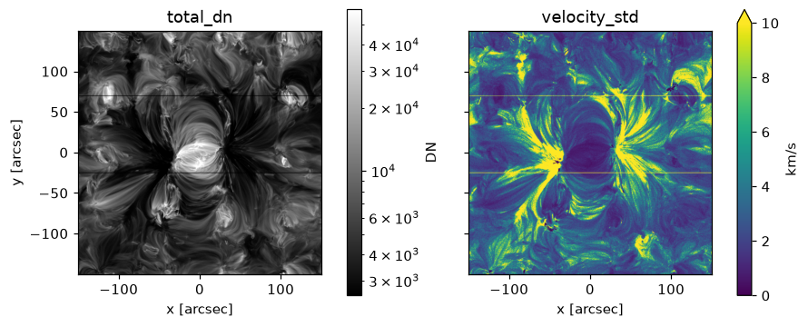
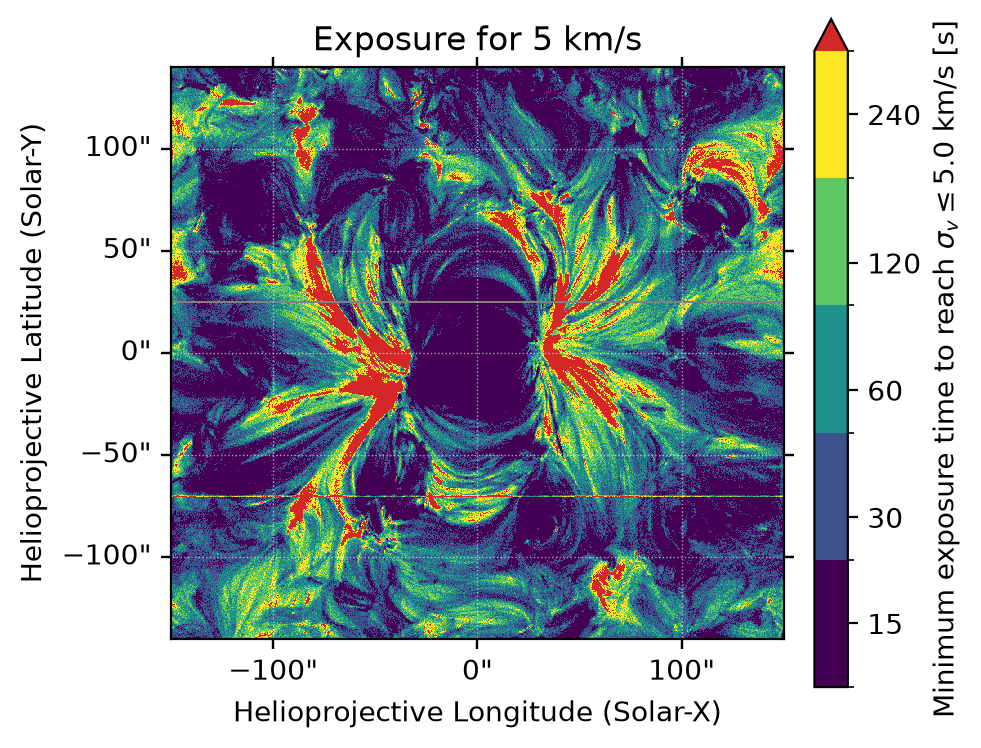

# Analysing an observation

<div class="glance" markdown>
<div markdown>
**You need**

A [results file](../files/results.md)
</div>
<div markdown>
**You run**

Python, with ECLIPSE's analysis functions
</div>
<div markdown>
**You get**

Each line's precision, maps, and the exposure each pixel needs
</div>
</div>

The examples read the sweep from [Simulating an observation](../observe/simulate.md): the [worked example](../worked-example.ipynb)'s active region, with eight combinations of settings.

## Loading the results

```python
from eclipse import load_instrument_response_results, summary_table

results = load_instrument_response_results("run/result/muram_ar_sweep.h5")
summary_table(results)
```

`summary_table` prints the settings of every combination and the fitted components.

## Picking a combination

`get_results_for_combination` picks out one combination by its settings, named as `summary_table` prints them:

```python
import astropy.units as u
from eclipse import get_results_for_combination

combination = get_results_for_combination(results, **{
    "simulation.expos": 60 * u.s,
    "simulation.slit_width": 0.4 * u.arcsec,
    "offchip_bin_slit": 2,
})
```

`get_parameter_combinations(results)` lists every combination's settings.

## How precisely each line was measured

```python
import numpy as np
from eclipse import analyse_fit_statistics

stats = analyse_fit_statistics(combination)
print(f"{np.nanmedian(stats['v_std']):.2f}")
```

```text
2.80 km / s
```

`analyse_fit_statistics` gives a value per pixel of:

| Key | What it is |
| --- | --- |
| `v_first`, `w_first`, `i_first` | The velocity, width and intensity from the first Monte Carlo iteration |
| `v_mean`, `w_mean`, `i_mean` | Their means over the iterations |
| `v_std`, `w_std`, `i_std` | Their standard deviations over the iterations: how precisely they were measured |
| `v_true`, `w_true` | The true velocity and width |
| `v_err` | The true velocity minus the mean measured velocity |
| `failed_fits`, `n_iterations` | The number of fits that failed, and the number of iterations |

The width is the Gaussian's sigma. `data_type="photon"` gives the [photon fits](../observe/fitting.md#which-signals-are-fitted) in place of the DN fits.

### Comparing combinations

Going through a sweep:

```python
from eclipse import get_parameter_combinations

for settings in get_parameter_combinations(results):
    chosen = {key: settings[key] for key in
              ("simulation.slit_width", "simulation.expos", "offchip_bin_slit")}
    stats = analyse_fit_statistics(get_results_for_combination(results, **chosen))
    print(*chosen.values(), f"{np.nanmedian(stats['v_std']):.2f}")
```

```text
0.2 arcsec 15.0 s 1 10.68 km / s
0.2 arcsec 15.0 s 2 7.05 km / s
0.2 arcsec 60.0 s 1 4.54 km / s
0.2 arcsec 60.0 s 2 3.14 km / s
0.4 arcsec 15.0 s 1 9.13 km / s
0.4 arcsec 15.0 s 2 6.13 km / s
0.4 arcsec 60.0 s 1 4.02 km / s
0.4 arcsec 60.0 s 2 2.80 km / s
```

### Every component of a blend

`list_fit_components` names the components of a [blend](../observe/fitting.md), and `component=` picks one:

```python
from eclipse import list_fit_components

for name in list_fit_components(combination):
    stats = analyse_fit_statistics(combination, component=name)
    print(name, f"{np.nanmedian(stats['i_mean']):.0f}")
```

```text
Fe XII 195.119 2436 DN
Fe XII 195.179 71 DN
```

## The truth

`v_true` and `w_true` are fitted to the spectra on the detector's pixels with no noise and no PSF. `v_err` says how far the velocity is off on average, and `v_std` how much it scatters.

## Maps { data-routes="mhd spectra dem" }

`create_sunpy_maps_from_combo` makes SunPy maps of a combination's results:

```python
from eclipse import create_sunpy_maps_from_combo

maps = create_sunpy_maps_from_combo(combination, date_obs="2026-01-01T00:00:00")
maps["velocity_std"].peek()
```

The maps need a `date_obs`, except for an EIS run with a dated calibration. They are:

| Map | What it is | Unit |
| --- | --- | --- |
| `total_dn` | The first iteration's signal, summed over wavelength | DN |
| `total_photons` | The first iteration's photons arriving at the detector, summed over wavelength | photons |
| `velocity_from_fit`, `velocity_mean`, `velocity_std` | The first iteration's fitted velocity, the mean over the iterations, and the standard deviation | km/s |
| `velocity_true`, `velocity_err` | The true velocity, and the true velocity minus the mean | km/s |
| `line_width_from_fit`, `line_width_mean`, `line_width_std` | The same for the line width, the Gaussian's sigma | Angstrom |
| `intensity_from_fit`, `intensity_mean`, `intensity_std` | The same for the intensity, the fitted line's counts | DN, or photons with `data_type="photon"` |
| `failed_fits` | The number of fits that failed in each pixel | none |

It takes `data_type` and `component` too. These are `total_dn` and `velocity_std`:



Given the combinations at each exposure as `exposure_time_results`, it also makes an `exposure_time` map: the shortest exposure that measures each pixel's velocity to within `precision_requirement`. From [an exposure sweep](https://github.com/jamesmckevitt/eclipse/blob/master/tools/docs_examples/muram_ar_exposures.yaml):

```python
results = load_instrument_response_results("run/result/muram_ar_exposures.h5")
exposures = [get_results_for_combination(results, **{"simulation.expos": settings["simulation.expos"]})
             for settings in get_parameter_combinations(results)]
maps = create_sunpy_maps_from_combo(exposures[0], exposure_time_results=exposures,
                                    precision_requirement=5 * u.km / u.s,
                                    date_obs="2026-01-01T00:00:00")
maps["exposure_time"].peek()
```



## Every iteration

With `save_iterations: true` in the [fitting section](../observe/fitting.md#the-fit), `combination["dn_fit_stats"]["iterations"]` holds every iteration's fit, as `fit_data` and `failed`.

## The synthesis behind the results { data-routes="mhd dem" }

The DEM and emission measure are in the [synthesis file](../files/synthesis.md), read with `read_synthesis_products`. For a [raster](../observe/rasters.md), `results["raster"]` holds the observing plan and the cube observed.
