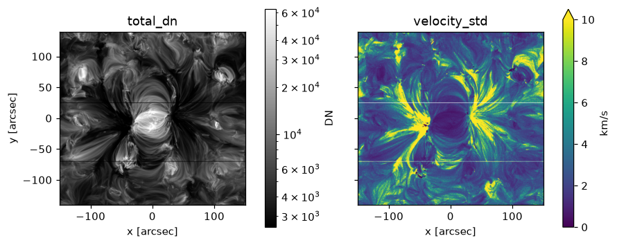
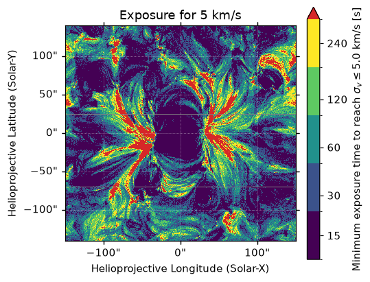

# Analysing the results

`eclipse` writes its results to `run/result/<config name>.h5`. ECLIPSE's analysis functions read them, and pick out the measurements you need.

The examples on this page read the sweep from [Running a simulation](instrument-response.md), which observed the active region of the [worked example](worked-example.ipynb) with eight combinations of settings.

## Loading the results

```python
from eclipse import load_instrument_response_results, summary_table

results = load_instrument_response_results("run/result/muram_ar_sweep.h5")
summary_table(results)
```

`summary_table` prints the version of ECLIPSE and the git commit that made the results, the settings of every combination, which settings were swept, and the names of the fitted components.

## Picking a combination

A run makes one set of results for each combination of the settings it swept through. `get_results_for_combination` picks one out, by the names `summary_table` prints: the section and key, such as `simulation.expos`. Python keyword arguments can't have a dot in them, so they are given as a dictionary:

```python
import astropy.units as u
from eclipse import get_results_for_combination

combination = get_results_for_combination(results, **{
    "simulation.expos": 60 * u.s,
    "simulation.slit_width": 0.4 * u.arcsec,
    "offchip_bin_slit": 2,
})
```

Values with units need their units. If what you give matches more than one combination, or none, it stops with an error saying so. `get_parameter_combinations(results)` lists the settings of every combination.

## How precisely each line was measured

```python
import numpy as np
from eclipse import analyse_fit_statistics

stats = analyse_fit_statistics(combination)
print(f"{np.nanmedian(stats['v_std']):.2f}")
```

```text
2.80 km / s
```

This is the median over the whole field of the velocity's standard deviation.

`analyse_fit_statistics` gives maps, with one value per pixel, of the fitted line's:

| Key | What it is |
| --- | --- |
| `v_first`, `w_first`, `i_first` | The velocity, width and intensity from the first Monte Carlo iteration |
| `v_mean`, `w_mean`, `i_mean` | Their means over the iterations |
| `v_std`, `w_std`, `i_std` | Their standard deviations over the iterations: how precisely they were measured |
| `v_true`, `w_true` | The true velocity and width |
| `v_err` | The true velocity minus the mean measured velocity |
| `failed_fits`, `n_iterations` | The number of fits that failed, and the number of iterations |

The width is the Gaussian's sigma, and the intensity is the fitted line's counts. Failed fits are left out of the means and standard deviations.

By default these are the fits to the signal in DN. `data_type="photon"` gives the fits to the photons arriving at the detector instead, if the run fitted them (see [Which signals are fitted](fitting.md#which-signals-are-fitted)).

### Comparing combinations

`get_parameter_combinations` makes it easy to go through a sweep:

```python
from eclipse import get_parameter_combinations

for settings in get_parameter_combinations(results):
    chosen = {key: settings[key] for key in
              ("simulation.slit_width", "simulation.expos", "offchip_bin_slit")}
    stats = analyse_fit_statistics(get_results_for_combination(results, **chosen))
    print(*chosen.values(), f"{np.nanmedian(stats['v_std']):.2f}")
```

```text
0.2 arcsec 15.0 s 1 10.68 km / s
0.2 arcsec 15.0 s 2 7.05 km / s
0.2 arcsec 60.0 s 1 4.54 km / s
0.2 arcsec 60.0 s 2 3.14 km / s
0.4 arcsec 15.0 s 1 9.13 km / s
0.4 arcsec 15.0 s 2 6.13 km / s
0.4 arcsec 60.0 s 1 4.02 km / s
0.4 arcsec 60.0 s 2 2.80 km / s
```

### Every component of a blend

When a [blend](fitting.md) is fitted, the results hold every component. `list_fit_components` names them, and `component=` picks one; without it, `analyse_fit_statistics` gives the primary component:

```python
from eclipse import list_fit_components

for name in list_fit_components(combination):
    stats = analyse_fit_statistics(combination, component=name)
    print(name, f"{np.nanmedian(stats['i_mean']):.0f}")
```

```text
Fe XII 195.119 2436 DN
Fe XII 195.179 71 DN
```

For each component, the statistics also hold its name as `component`, its rest wavelength as `rest_wavelength`, and what it is tied to as `tied`.

## The truth

The truth is what ECLIPSE fits to the spectra on the detector's pixels, with no noise and no PSF. `v_true` and `w_true` come from that fit. `v_err` then says how far the measured velocity is off on average, where `v_std` says how much it scatters.

## Maps

`create_sunpy_maps_from_combo` makes SunPy maps of a combination's results:

```python
from eclipse import create_sunpy_maps_from_combo

maps = create_sunpy_maps_from_combo(combination, date_obs="2026-01-01T00:00:00")
maps["velocity_std"].peek()
```

A synthesised scene has no date of its own, so the maps need one from you, as `date_obs`. The only exception is an EIS run with a dated calibration, whose date is used. The maps are:

| Map | What it is | Unit |
| --- | --- | --- |
| `total_dn` | The first iteration's signal, summed over wavelength | DN |
| `total_photons` | The first iteration's photons arriving at the detector, summed over wavelength | photons |
| `velocity_from_fit`, `velocity_mean`, `velocity_std` | The first iteration's fitted velocity, the mean over the iterations, and the standard deviation | km/s |
| `velocity_true`, `velocity_err` | The true velocity, and the true velocity minus the mean | km/s |
| `line_width_from_fit`, `line_width_mean`, `line_width_std` | The same for the line width, the Gaussian's sigma | Angstrom |
| `intensity_from_fit`, `intensity_mean`, `intensity_std` | The same for the intensity, the fitted line's counts | DN, or photons with `data_type="photon"` |
| `failed_fits` | The number of fits that failed in each pixel | none |

Each map also holds its unit, as `maps["velocity_std"].unit`.

It takes `data_type` and `component` as `analyse_fit_statistics` does. Given the combinations at each exposure time as `exposure_time_results`, it also makes an `exposure_time` map: the shortest of those exposures, in seconds, at which each pixel's velocity is measured to within `precision_requirement`, 2 km/s by default.

These are `total_dn` and `velocity_std` of this combination:



The velocity is measured to about 1 km/s in the core, and to about 4 km/s in the quiet Sun. It is worst in the fans beside the core, where the line is faintest. The two thin lines are the slit's fiducials.

An exposure sweep gives the `exposure_time` map. [This run](https://github.com/jamesmckevitt/eclipse/blob/master/tools/docs_examples/muram_ar_exposures.yaml) observes the region with the 0.4 arcsec slit and two pixels binned, in exposures of 15, 30, 60, 120 and 240 s, with 30 iterations:

```python
results = load_instrument_response_results("run/result/muram_ar_exposures.h5")
exposures = [get_results_for_combination(results, **{"simulation.expos": settings["simulation.expos"]})
             for settings in get_parameter_combinations(results)]
maps = create_sunpy_maps_from_combo(exposures[0], exposure_time_results=exposures,
                                    precision_requirement=5 * u.km / u.s,
                                    date_obs="2026-01-01T00:00:00")
maps["exposure_time"].peek()
```



## Every iteration

With `save_iterations: true` in the [fitting section](fitting.md#the-fit), the results also keep every iteration's fit. `combination["dn_fit_stats"]["iterations"]` holds `fit_data`, every fitted value of every iteration, and `failed`, which marks the fits that failed.

## The synthesis behind the results

The DEM and the emission measure by temperature and velocity are in the synthesis file, not in the results. `read_synthesis_products` reads them; see [Files](files.md#synthesis-files). A time series of atmosphere files is synthesised during the run and writes no synthesis file, so these are not kept for it.

For a [time series](time-series.md), `results["raster"]` holds the observing plan, the files and their times, and the cube each combination observed. With more than one raster, `raster.repeat` picks one out like any other setting.

Results files from ECLIPSE 0.11.0 and earlier were pickles; see [Older versions](older-versions.md).
