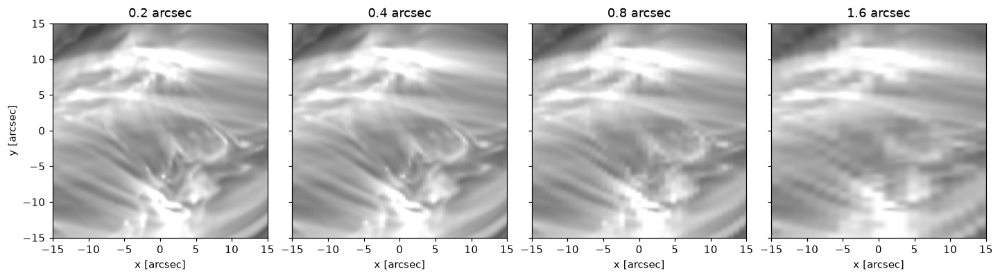
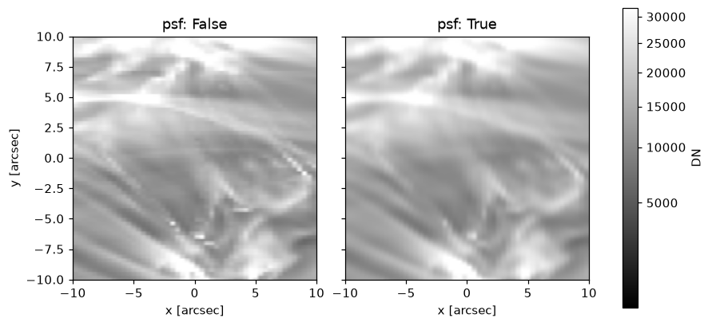
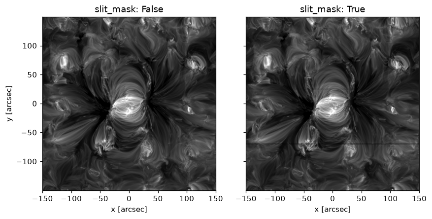

# The instrument model

ECLIPSE follows the light from the Sun through the telescope, the point spread function (PSF) and the slit, to the detector, which turns photons into electrons with their noise, adds dark current and read noise, and digitises them. This page covers the parts with settings of their own. [Run file settings](../reference/run-file-settings.md) lists every setting, and [Instrument sources](instrument-sources.md) where each default comes from.

## The instruments

`instrument:` chooses `SWC`, SOLAR-C/EUVST's short wavelength channel (the default), or `EIS`, Hinode/EIS.

### EUVST-SW

The default settings describe EUVST-SW, as in [McKevitt et al. (2026), PASJ 78, 1524](https://academic.oup.com/pasj/article/78/4/1524/8731000). Its slits are 0.2, 0.4, 0.8 and 1.6 arcsec wide, and a wider slit gives coarser pixels across the slit:



### Hinode/EIS

Its slits are 1 and 2 arcsec wide; the slots are not modelled. The `filter:` section and `telescope.microroughness_sigma` are ignored for EIS, with a warning, and pinholes are refused. Its PSF is a Gaussian 3 pixels wide (Ugarte-Urra 2016, EIS Software Note 2).

#### EIS effective area

`telescope.calibration` chooses the EIS effective area. The in-flight calibrations need the observation's `date`:

```yaml
instrument: EIS
telescope:
  calibration: dz2025
  date: "2012-06-03"    # quoted, so YAML keeps it a string
```

| `calibration` | Source |
|---|---|
| `ground` (default) | Pre-flight MSSL tables, `eis_ea.pro` |
| `dz2013` | Del Zanna (2013), `eis_ltds.pro` |
| `warren2014` | Warren, Ugarte-Urra & Landi (2014) |
| `dz2025` | Del Zanna et al. (2025), `interpol_eis_ea.pro` |

## The point spread function

`simulation.psf: True` blurs the spectra along the slit and in wavelength. It is off by default.



### The SW PSF along the slit

The SW PSF is the worst case over `telescope.field_of_view`: `280x280` (default), `100x100` or `70x70` arcsec.

```yaml
telescope:
  field_of_view: 70x70
simulation:
  psf: True
```

### The spectral PSF and the slit

In wavelength, the optics' blur is combined with the slit's image: added in quadrature (`spectral_psf: quadrature`, the default), or convolved with it (`convolution`, SWC only).

```yaml
simulation:
  slit_width: [0.2 arcsec, 1.6 arcsec]
  psf: True
  spectral_psf: convolution
```

### The edges of the atmosphere

`simulation.psf_boundary` sets what the blur brings in from beyond the atmosphere: more of the edge cells (`replicate`, the default), or nothing (`zero`), which darkens the pixels near the edges.

## The slit's fiducials

Each SWC slit is 280 arcsec long, with two fiducials, 25 arcsec north and 70 arcsec south of its centre, that block the light. `simulation.slit_mask: True` darkens the pixels behind them and beyond the slit's ends, and leaves the fits there blank.

```yaml
simulation:
  slit_width: 0.4 arcsec
  psf: True
  slit_mask: True
```



## Visible light

`simulation.vis_sl` adds visible stray light, in photons per second per cm2: before the filter for SWC, and at the CCD for EIS. `simulation.enable_pinholes` adds light through pinholes in SWC's filter; see [Pinholes](../reference/run-file-settings.md#pinholes).

## Dark current

For SWC, dark current is counted over the clear before the exposure, the exposure, and the wait to be read out, for the CCD rows of the observed window. `readout_dark_current: False` counts it over the exposure only, as for EIS.

## The pixels' width in wavelength

A pixel's width in wavelength changes slowly along the CCD, from 16.98 mA at 171 Angstrom to 16.86 mA at 211 Angstrom. A run uses `detector.wvl_res`, 16.9 mA, unless `simulation.focal_plane_dispersion: True`, which takes the width where the line lands (SWC only).
