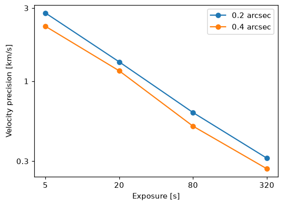

# From a single intensity

<div class="glance" markdown>
<div markdown>
**You need**

A line's total intensity
</div>
<div markdown>
**You run**

`eclipse run`
</div>
<div markdown>
**You get**

A [results file](../files/results.md) straight away; there is no synthesis file
</div>
<div markdown>
**Next**

[Analysing an observation](../analyse/observation.md)
</div>
</div>

ECLIPSE observes one Gaussian line of known total intensity, given in the [run file](../observe/simulate.md#the-run-file). All the scatter in the results then comes from the instrument, which suits uncertainty budgets, and there is no synthesis, so it is fast.

```yaml
instrument: SWC
uniform_intensity: 5000 erg / (s cm2 sr)   # units are required
rest_wavelength: 195.119 AA
thermal_width: 20 km/s                     # 1-sigma width, as a velocity

n_iter: 500
ncpu: -1

simulation:
  slit_width: [0.2 arcsec, 0.4 arcsec]
  expos: [5 s, 20 s, 80 s, 320 s]
  psf: True
```

```bash
eclipse run configs/uniform.yaml
```

The velocity's standard deviation over the iterations:



## Off-chip binning

[`offchip_bin_slit`](../observe/simulate.md#off-chip-slit-binning) works here too.

## The point spread function

With `psf: True` the line is blurred in wavelength only, as it is the same all along the slit.
