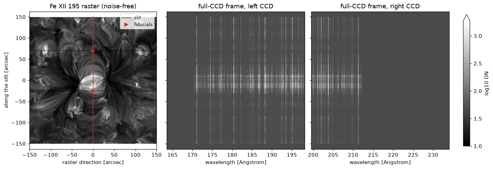
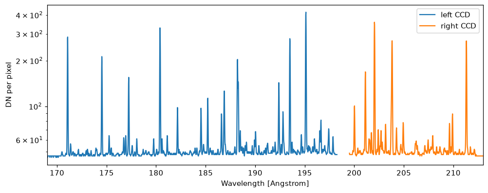

# A full-CCD frame

`eclipse` observes one spectral window at a time. A full-CCD frame is what the SW camera reads out at one slit position: both CCDs, with the prescan and overscan of each output.

A frame holds the spectra of a synthesis file, and nothing else. Every entry of the file is laid onto the CCDs at its own wavelengths. A file with three lines gives a frame with three lines. For a frame of the whole band, ECLIPSE synthesises every line in the band, and the continuum, into the file first.

This page makes the frame for the active region of the [worked example](worked-example.ipynb), with the slit through its core:



On the left is the Fe XII map of the region, observed without noise, with the slit in red. The triangles mark the slit's two fiducials. On the right is everything the two CCDs record through that slit in one 60 s exposure. Each vertical streak is one spectral line, seen all the way along the slit. The bright band across them is the core of the region, where the slit crosses it. The grey background is the detector's dark current and noise.

## From an MHD simulation

A [run file](run-files.md#a-full-ccd-frame) with an `atmosphere` and a `frame:` section makes the frame with one command. The `frame:` section says where the slit is and whether to add the continuum, and the other sections set the instrument as in a run. Write this to `slit_core.yaml`:

```yaml
instrument: SWC
atmosphere: muram_ar_1160000.h5

simulation:
  slit_width: 0.4 arcsec
  expos: 60 s
  psf: True
  slit_mask: True

frame:
  slit_position: 0 arcsec
  continuum: True
  n_workers: 16
```

and make the frame with:

```bash
eclipse frame slit_core.yaml
```

This does three things:

1. It works out the contribution function of every CHIANTI line from 169 to 213.5 Angstrom, and keeps them in `run/input/band_lines.h5`. The whole band takes a few hours on 32 cores, and is only worked out once. Later frames read the file back.
2. It synthesises the band's spectrum, with the continuum, in the part of the image under the slit, into the synthesis file `run/input/slit_core_band.h5`.
3. It makes the frame from that file, and writes it to `run/result/slit_core_frame.h5`.

The band is synthesised with the run's `synthesis:` settings, such as its abundances and its view, if it has any. A run's own `lines` are not used.

A run file with an `emission_measure` in place of the `atmosphere` makes a frame from a [DEM or VDEM](dem-synthesis.md#a-full-ccd-frame) the same way.

`slit_position` is where the middle of the slit is, across it, in the image's x coordinates. Along the slit, the middle of the image is at the middle of the slit, which is the middle column of the CCDs.

## From your own spectra

A run file with a `synthesis_file` in place of the `atmosphere` makes the frame from the spectra in that file, as they are:

```yaml
instrument: SWC
synthesis_file: my_spectra.h5

simulation:
  expos: 60 s
  psf: True

frame:
  slit_position: 0 arcsec
```

The file can be from [another code](other-codes.md) or from ECLIPSE. Its spectra can cover the whole band or a few windows, and the rows no spectrum reaches record only the detector's dark current and noise. The entries of the file are added, so where two windows overlap, each should hold different emission.

## The band's spectrum

The band's spectrum is synthesised on evenly spaced wavelengths, 0.002 Angstrom apart, about a ninth of a detector row. Each value is the mean radiance over its wavelength bin. Every line is integrated over the bins, so all of its light is kept whatever the spacing. `band_step` in the `frame:` section sets another spacing.

The lines come only from plasma within the synthesis's velocity grid, so set `vel_lim` in the `synthesis:` section wide enough for the fastest flows. The continuum is not Doppler shifted, and comes from all the plasma.

`synthesise-spectra` makes the same file with `--band` in place of `--lines`:

```bash
synthesise-spectra \
  --atmosphere muram_ar_1160000.h5 \
  --band "169 Angstrom" "213.5 Angstrom" \
  --continuum \
  --image-x "-1 Mm" "1 Mm" \
  --output-name muram_ar_band.h5
```

`--image-x` keeps only the part of the image between two positions across the slit. A band's spectrum has about 22000 wavelengths in every pixel, so a whole image of it can need tens of gigabytes.

## From Python

`full_ccd_frame` makes a frame from a synthesis file:

```python
import astropy.units as u
from eclipse import full_ccd_frame, write_full_frame

frame = full_ccd_frame("run/input/muram_ar_band.h5", slit_position=0 * u.arcsec,
                       exposure=60 * u.s, slit_width=0.4 * u.arcsec, slit_mask=True)
write_full_frame(frame, "frame.h5")
```

The result is the frame at the top of this page. `dn` holds it as it is read out, with the prescan and overscan of each output, and `rate` holds the photons reaching each pixel. The median of the image columns in each row gives the spectrum of the whole band:

```python
import matplotlib.pyplot as plt
import numpy as np

pre, over = frame.settings["serial_prescan"], frame.settings["serial_overscan"]
fig, ax = plt.subplots(figsize=(9, 3.5), layout="constrained")
for ccd in ("left", "right"):
    rows = frame.wavelength[ccd].to_value(u.AA)
    half = frame.rate[ccd].shape[1] // 2
    columns = np.r_[pre:pre + half, pre + half + 2 * over:pre + 2 * half + 2 * over]
    order = np.argsort(rows)
    spectrum = np.median(frame.dn[ccd][:rows.size, columns], axis=1)
    ax.plot(rows[order], spectrum[order], label=f"{ccd} CCD")
ax.set_xlim(169, 213)
ax.set_yscale("log")
ax.set_xlabel("Wavelength [Angstrom]")
ax.set_ylabel("DN per pixel")
ax.legend()
plt.show()
```



A frame takes the synthesis file's y to increase towards solar north, as in nominal observations. Each CCD's columns count from its left output, as the camera reads them. On the left CCD, that is from the north end of the slit. The right CCD faces the other way, with its serial register on its own outer edge, so its columns count from the south end. `field_angle` gives the angle of each column along the slit.

With the PSF on, the blur along the slit carries light out of the columns at the ends of the scene. `psf_boundary` sets what the blur brings in from beyond the scene, as in a run. With `"replicate"`, the default, the Sun beyond the scene is taken to look like the scene's edges, and the columns beyond the scene get no light. With `"zero"`, the Sun beyond the scene is dark, so the columns at the ends of the scene lose up to about a third of their light to the columns just beyond. `psf_boundary` sets the same across the slit, for a slit near the synthesis's x edges. With `"replicate"`, a slit partly beyond those edges gets light only over its part inside them.

With `slit_mask=True`, no light reaches the columns beyond the ends of the 280 arcsec slit or behind its fiducials, as in a run (see [The slit's fiducials](instrument-model.md#the-slits-fiducials)). The CCD's 2048 columns cover 326 arcsec along the slit, so about 144 columns at each end are beyond the slit. It is off by default.

The slit width, PSF and noise can instead be taken from a `Simulation`, as in an instrument-response run:

```python
from eclipse import Simulation

sim = Simulation(slit_width=0.4 * u.arcsec, psf=True, noise=True, slit_mask=True)
frame = full_ccd_frame("run/input/muram_ar_band.h5", slit_position=0 * u.arcsec,
                       exposure=60 * u.s, sim=sim)
```

The frame uses the `Simulation`'s `slit_width`, `psf`, `spectral_psf`, `noise`, `psf_boundary` and `slit_mask`. A `Simulation` has the PSF off unless it is made with `psf=True`. When one of these six arguments of `full_ccd_frame` equals its default, the `Simulation`'s value is used, even if the argument was typed out. An argument with any other value must agree with the `Simulation`. The exposure is set by `exposure`, not by the `Simulation`'s `expos`. A frame does not model pinholes or visible stray light. `vis_sl` must be left at zero and no pinholes enabled. `instrument` must be `"SWC"`.

Each wavelength of the spectra is counted in photons of its own energy, with the telescope's throughput there, and the photons in each pixel free the electrons of their own energy. Wavelengths outside the telescope's throughput tables, from 170 to 214 Angstrom, give no light.

## What a frame holds

For each CCD, `"left"` and `"right"`:

- `rate`: the photons per second reaching each image pixel;
- `photons`: the photons in each pixel over the exposure;
- `dn`: the frame as it is read out, in DN;
- `wavelength`: the wavelength each row records;
- `field_angle`: the angle along the slit of each column, from the slit's centre, positive towards solar north in nominal observations;
- `photon_wavelength`: the wavelength of the mean energy of each pixel's photons;
- `photon_rms_wavelength`: the wavelength of the root mean square energy of each pixel's photons, which sets how far their electrons spread.

`dn` holds each row as the two outputs read it: the left output's prescan, the first half of the image, the left output's overscan, the right output's overscan, the second half of the image and the right output's prescan. The parallel overscan rows follow the image's rows.

## How a frame differs from a run

A frame and an `eclipse` run share the instrument's throughput, PSF and detector settings, but they do not yet model all the same effects:

| Effect | `eclipse` run | Full-CCD frame |
| --- | --- | --- |
| Pinholes in the filter | with `simulation.enable_pinholes` | not modelled |
| Visible stray light | with `simulation.vis_sl` | not modelled |
| Dark current | over the clear, the exposure and the read-out of its own rows alone, unless `simulation.readout_dark_current` is `False` | over the clear, the exposure and the read-out of every row |
| Wavelength of each pixel | a fixed step, `detector.wvl_res`, or with `simulation.focal_plane_dispersion` the focal plane's step where the line lands | the focal plane's dispersion, from 17.0 to 16.8 mA per row |
| The 1 mm gap between the CCDs | not modelled: a window sees an unbroken spectrum | no rows from 198.26 to 199.51 Angstrom |
| Rows outside the 170.0 to 212.3 Angstrom band | lit | dark |
| Smear without a shutter, and charge transfer | refused | modelled |
| Prescan and overscan | none | both |
