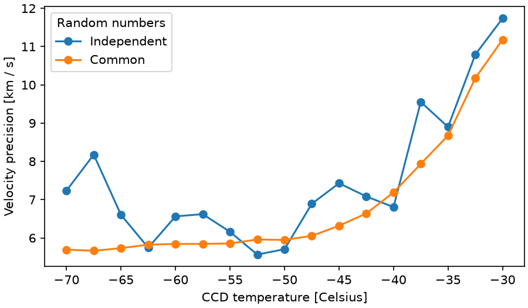

# Common random numbers

Giving the runs being compared the same random numbers, [common random numbers](https://en.wikipedia.org/wiki/Variance_reduction#Common_Random_Numbers_%28CRN%29), makes most of their noise cancel. Seed NumPy with the same value before each run, and draw what differs between the runs by [inverse-transform sampling](https://en.wikipedia.org/wiki/Inverse_transform_sampling): `dark_current_inverse_transform` for the dark current, as here, or `photon_shot_inverse_transform` for the photons. Both are off by default, as they are slower. Under MPI, the runs need the same number of ranks.

```python
--8<-- "docs/gallery/common_random_numbers.py"
```



[Download the script](common_random_numbers.py) | [All examples](index.md)
