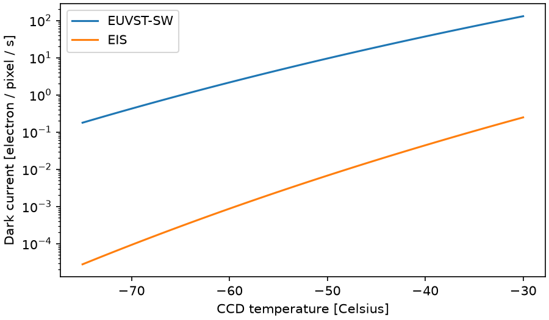

# Dark current

The dark current of each CCD against its temperature, set by `ccd_temperature`.

```python
--8<-- "docs/gallery/dark_current.py"
```



[Download the script](dark_current.py) | [All examples](index.md)
