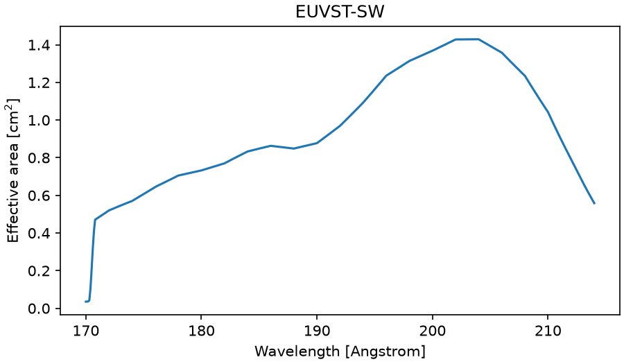

# Effective area

The telescope's collecting area times its throughput, times the detector's quantum efficiency.

```python
--8<-- "docs/gallery/effective_area.py"
```



[Download the script](effective_area.py) | [All examples](index.md)
