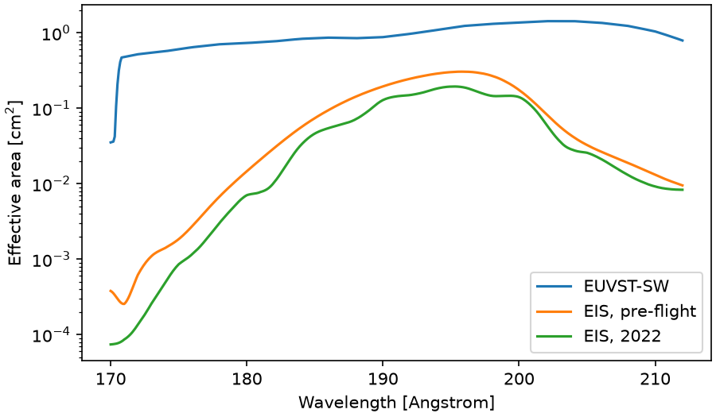

# EUVST-SW and EIS

The effective area of EUVST-SW and of the short-wavelength band of Hinode/EIS. EIS has lost sensitivity since launch, so its calibrations after launch need a date.

```python
--8<-- "docs/gallery/euvst_and_eis.py"
```



[Download the script](euvst_and_eis.py) | [All examples](index.md)
