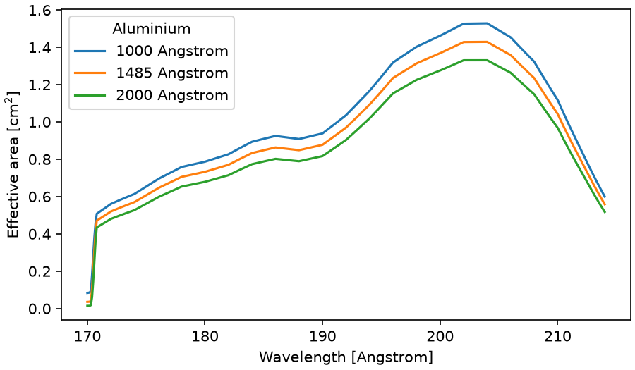

# Filter thickness

The effective area with a thinner and a thicker aluminium filter than the default 1485 Angstrom.

```python
--8<-- "docs/gallery/filter_thickness.py"
```



[Download the script](filter_thickness.py) | [All examples](index.md)
