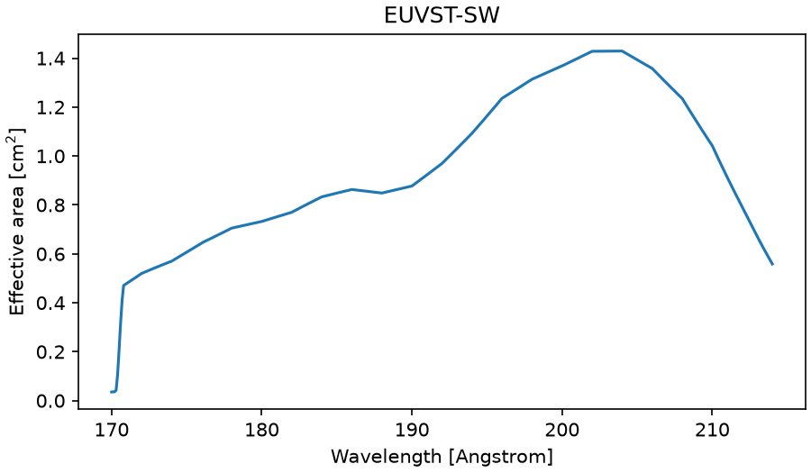
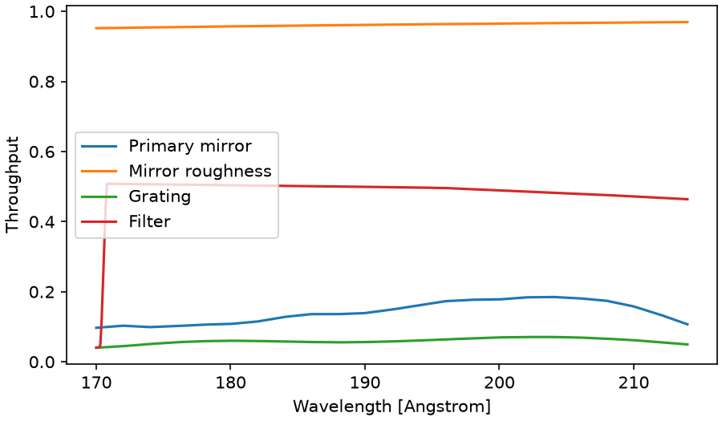
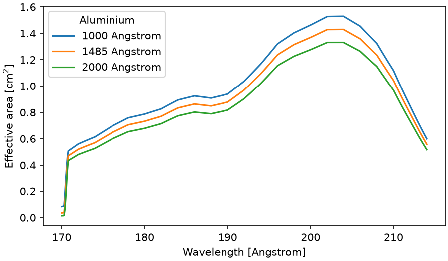
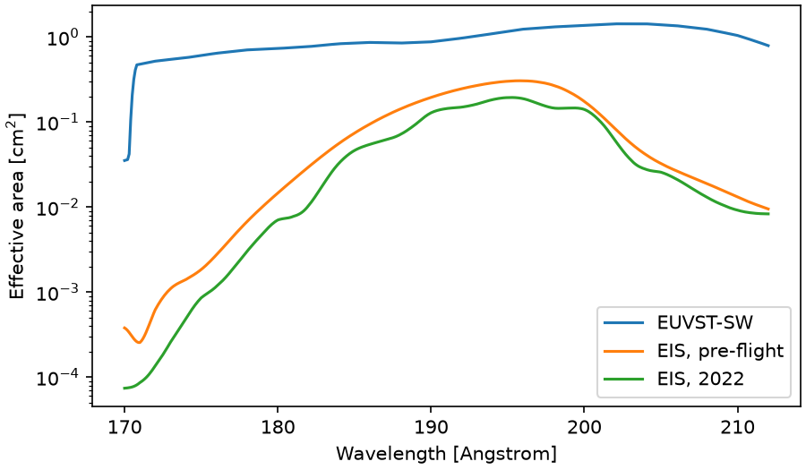
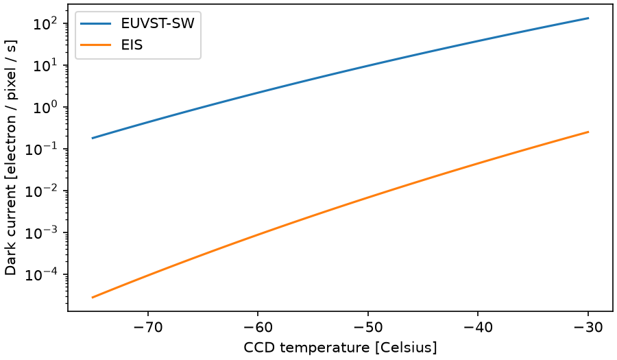
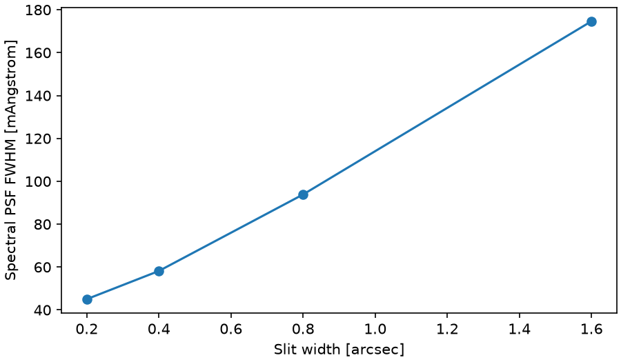
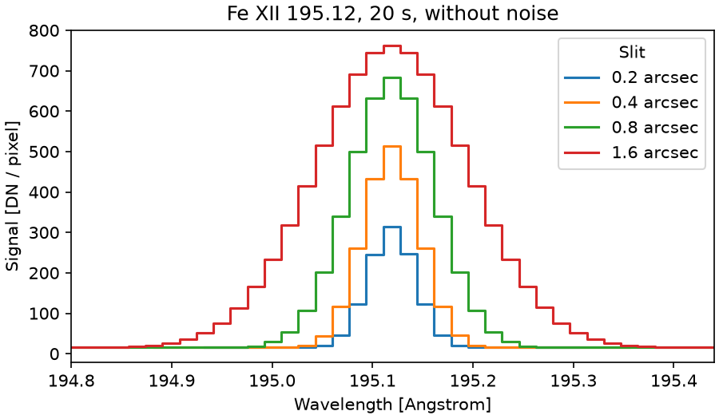
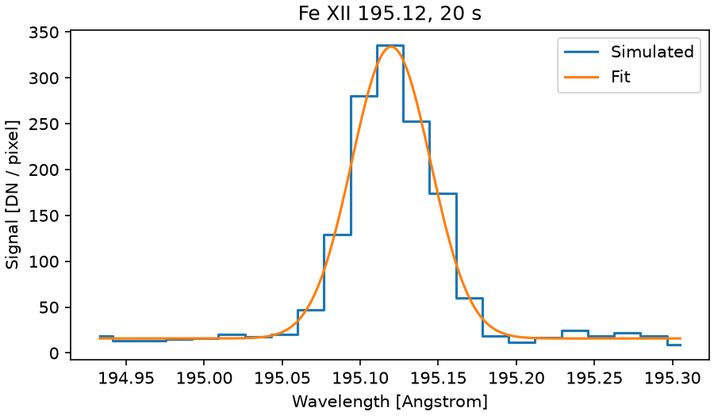
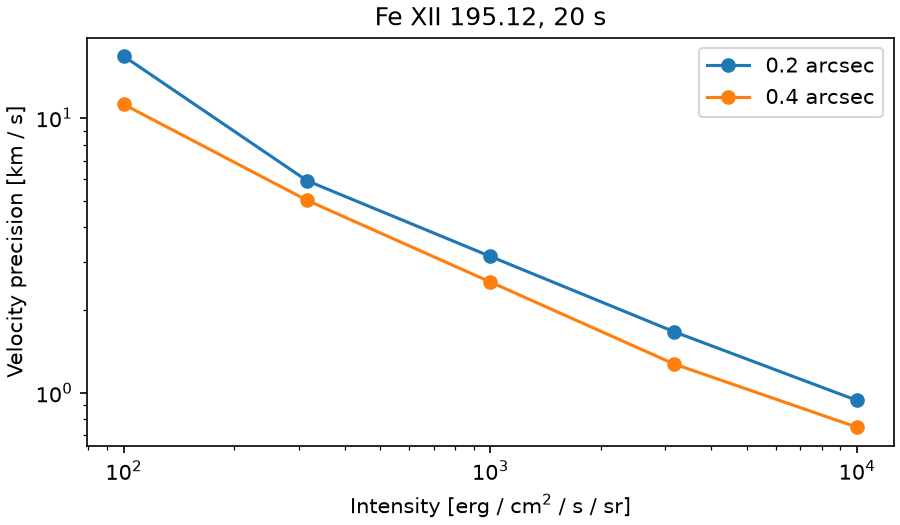
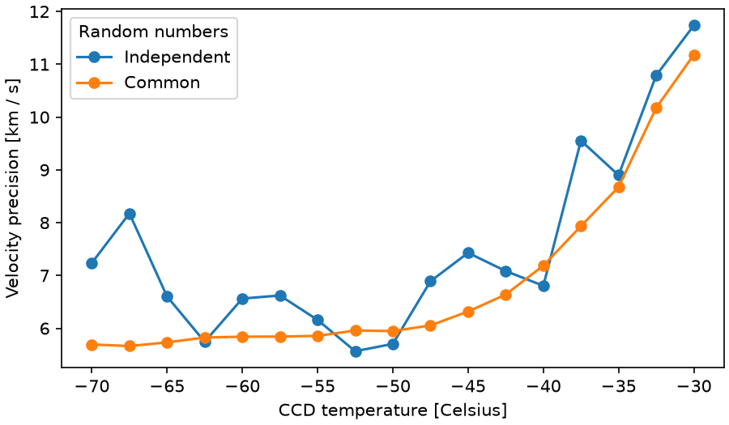

# Example gallery

Short scripts that use the `eclipse` package from Python. Each page shows a script's code and its figure, and links to the script. The [API reference](../api.md) lists everything they use, and [Run files](../run-files.md#running-it-elsewhere) shows how to run a run file from Python.

## The instrument

-   

    [Effective area](effective-area.md)

-   

    [Throughput of each part](throughput.md)

-   

    [Filter thickness](filter-thickness.md)

-   

    [EUVST-SW and EIS](euvst-and-eis.md)

-   

    [Dark current](dark-current.md)

-   

    [Spectral PSF](spectral-psf.md)

## Simulating observations

-   

    [Slit width](slit-width.md)

-   

    [One exposure](one-exposure.md)

-   

    [Velocity precision](velocity-precision.md)

-   

    [Common random numbers](common-random-numbers.md)

