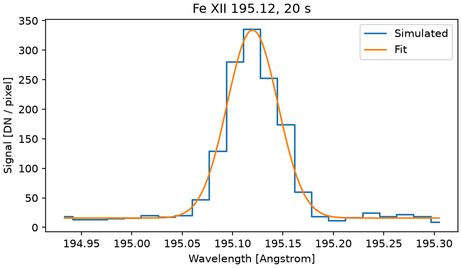

# One exposure

A single line in one simulated exposure, with noise, and a Gaussian fitted to it.

```python
--8<-- "docs/gallery/one_exposure.py"
```



[Download the script](one_exposure.py) | [All examples](index.md)
