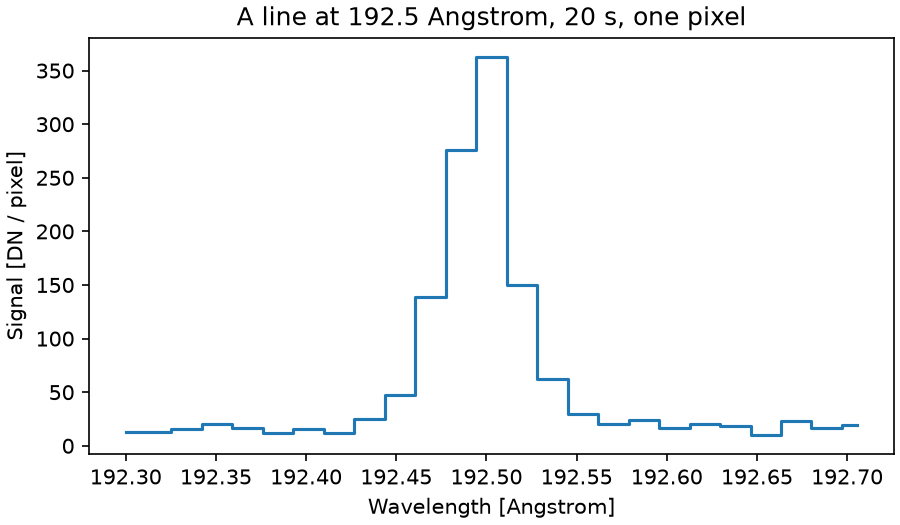

# Your own line

A line that is not in CHIANTI, or any spectra from your own code, written as a [synthesis file](../files/synthesis.md) and observed. Every pixel here has the same spectrum, where yours would come from your model.

```python
--8<-- "docs/gallery/own_line.py"
```



[Download the script](own_line.py) | [All examples](index.md)
