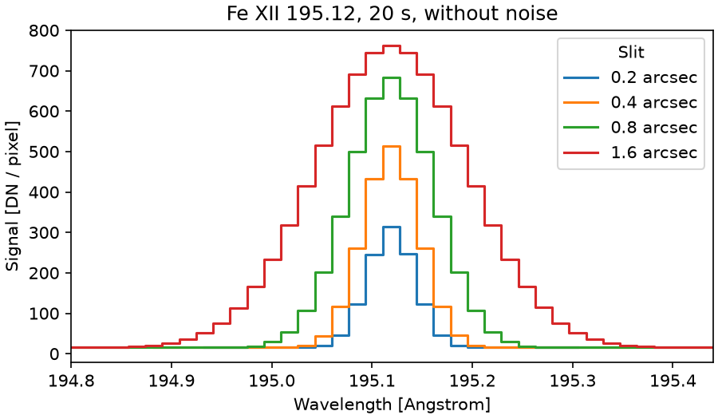

# Slit width

A line through each slit, without noise. A wider slit lets in more light, and its image on the detector widens the line.

```python
--8<-- "docs/gallery/slit_width.py"
```



[Download the script](slit_width.py) | [All examples](index.md)
