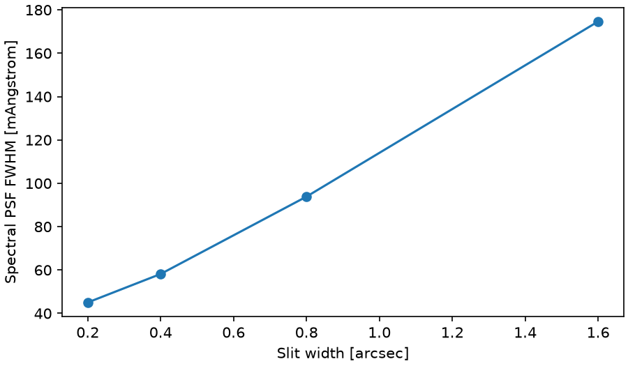

# Spectral PSF

The width of a line from the spectral PSF alone, for each slit.

```python
--8<-- "docs/gallery/spectral_psf.py"
```



[Download the script](spectral_psf.py) | [All examples](index.md)
