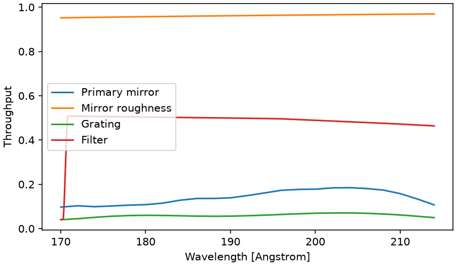

# Throughput of each part

The fraction of light each part of the telescope passes on.

```python
--8<-- "docs/gallery/throughput.py"
```



[Download the script](throughput.py) | [All examples](index.md)
