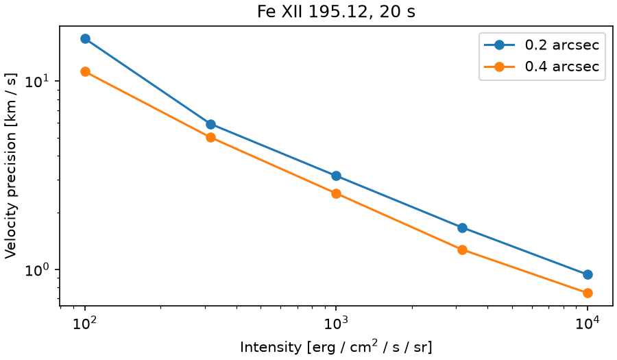

# Velocity precision

How precisely the Doppler velocity of a single line is measured, from many simulated exposures of it, each with new noise.

```python
--8<-- "docs/gallery/velocity_precision.py"
```



[Download the script](velocity_precision.py) | [All examples](index.md)
