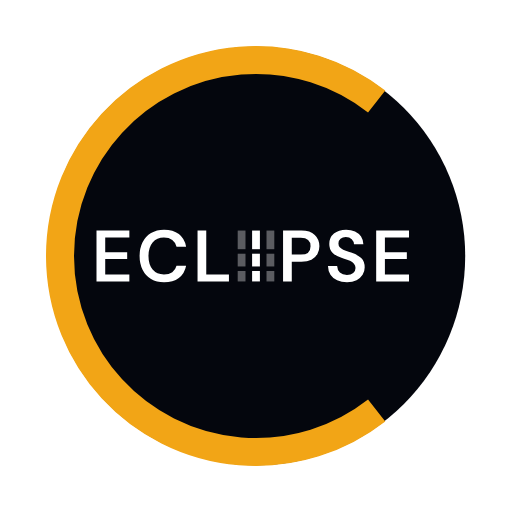

# ECLIPSE logo

The logo is a black disc with a gold C on its rim and ECLIPSE written inside it, with the I drawn as the slit of a spectrograph.

## What it shows

- The black disc is an eclipse.
- The gold C on the rim of the disc is the C of SOLAR-C, and of ECLIPSE. Its opening is on the right.
- The I of ECLIPSE is the slit of EUVST. The bold white bar is the slit. The two faint bars beside it are the next positions of the slit as it steps across the Sun, building up a raster.
- The two gaps in each bar are the slit's fiducials, 25 arcsec north and 70 arcsec south of the slit's centre. The bar stands for the 280 arcsec slit, so the gaps sit at the same fractions of its length as the fiducials do.
- The letters are as tall as the bar, so the slit reads as a letter of the word.

## Files

Each logo comes in two weights of lettering, SemiBold (`eclipse-logo`) and Bold (`eclipse-logo-bold`), and with two backgrounds. The ones with `-transparent` in the name have no background. The others sit on a white square. The SVG files are 256 by 256 units and the PNG files are 512 by 512 pixels.

- `eclipse-logo.svg`, `eclipse-logo-512.png`
- `eclipse-logo-bold.svg`, `eclipse-logo-bold-512.png`
- `eclipse-logo-transparent.svg`, `eclipse-logo-transparent-512.png`
- `eclipse-logo-bold-transparent.svg`, `eclipse-logo-bold-transparent-512.png`

The favicon is the disc and the C without the lettering. Its shapes are drawn on a 16 unit grid, so they are sharp at the size of a browser tab.

- `favicon.svg`, and `favicon-transparent.svg` without the white square
- `favicon.ico`, with 16, 32 and 48 pixel images
- `favicon-32.png`
- `apple-touch-icon.png`, 180 pixels, with the mark at 90% of the square, as iOS rounds the corners itself

## Design

- Gold is `#f2a516` and black is `#04060d`. They are not official UCL or mission colours.
- The lettering is UCL Sans, in capitals. UCL Sans is a version of DM Sans by Colophon Foundry, under the SIL Open Font License 1.1, which allows its use in logos. The letters are converted to outlines, so the files need no font.
