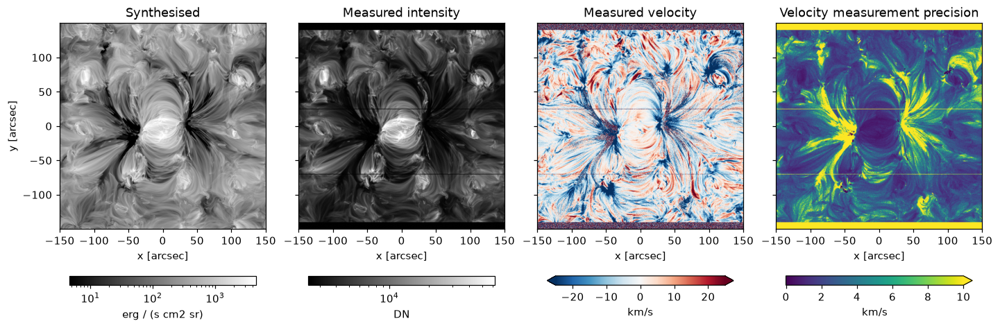
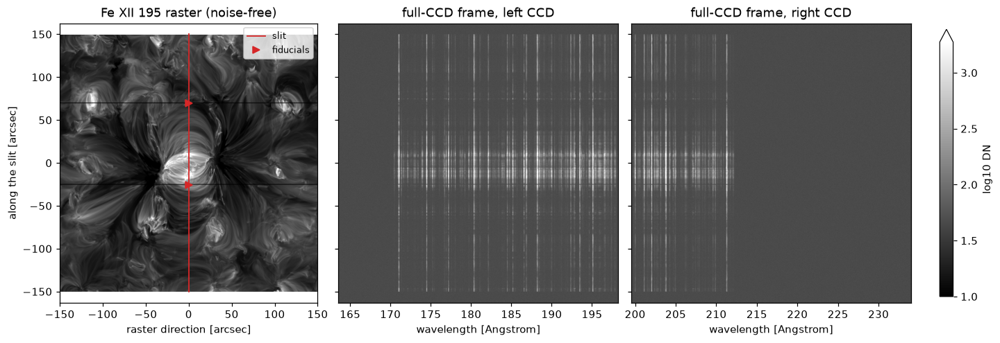

---
hide:
  - toc
---

<div class="home-aside" markdown>


Maintained at UCL Mullard Space Science Laboratory for SOLAR-C. Contact: James McKevitt (jm2@mssl.ucl.ac.uk). See [LICENSE](https://github.com/jamesmckevitt/eclipse/blob/master/LICENSE) for usage terms.
</div>

# ECLIPSE

**E**mission **C**alculation and **Li**ne **P**rediction for **S**OLAR-C **E**UVST

ECLIPSE predicts what the EUV spectrograph EUVST on SOLAR-C will measure, and how precisely, from a model of the solar atmosphere or from spectra you have made yourself. It also models Hinode/EIS.

The instrument model will be updated as EUVST is built, tested and commissioned.

<div class="install" markdown>
Install with

```bash
pip install eclipse
```

</div>

<div class="guide slim-steps four" data-v="3" data-fade-links data-global-route markdown>

<div class="have-bar" markdown>
<p class="have-question">What do you have?</p>
<div class="have-buttons" markdown>
[:material-circle-medium: A single intensity](#){ .have-button data-have="one" }
[:material-chart-bell-curve: A synthetic spectrum](#){ .have-button data-have="spectra" }
[:material-cube-outline: An MHD simulation](#){ .have-button data-have="mhd" }
[:material-chart-histogram: A DEM or VDEM](#){ .have-button data-have="dem" }
</div>
</div>

<div class="rows" markdown>
<div></div>
<div class="files four" markdown>

<div class="file c2" data-id="output" data-from="" data-to="spectra" data-have="spectra" markdown>
:material-file-code-outline:{ .ficon } **Your code's output**
<span>The spectra your code makes, in its own format.</span>
</div>

<div class="file c3" data-id="atmosphere" data-from="" data-to="mhd" data-have="mhd" markdown>
:material-database-outline:{ .ficon } [**Atmosphere file**](files/atmosphere.md)
<span>Your simulation's temperature, density and velocity, written in ECLIPSE's format.</span>
</div>

<div class="file c4" data-id="measure" data-from="" data-to="dem" data-have="dem" markdown>
:material-chart-histogram:{ .ficon } [**Emission measure file**](files/emission-measure.md)
<span>The emission measure at each temperature, and velocity for a VDEM.</span>
</div>

</div>
<div></div>
<div class="links short"><svg viewBox="0 0 100 40" preserveAspectRatio="none">
<path data-from="output" data-to="spectra" d="M37.5 0 L37.5 40"/>
<path data-from="atmosphere" data-to="mhd" d="M62.5 0 L62.5 40"/>
<path data-from="measure" data-to="dem" d="M87.5 0 L87.5 40"/>
</svg></div>
<div class="label" data-tier="1"><span class="step">1</span>Make the emission</div>
<div class="tier four" markdown>

<div class="box card" data-tier="1" data-id="one" data-route="one" data-to="obs" markdown>

### A single intensity

Give only a line's brightness, for the quickest estimate of how precisely it is measured.

[From a single intensity](emission/single-intensity.md){ data-routes="one" }
{: .card-links }

</div>

<div class="box card" data-tier="1" data-id="spectra" data-route="spectra" data-to="obs frame" markdown>

### Another code's spectra

Bring spectra that your own code has made, optically thin or thick.

[From another code](emission/other-codes.md){ data-routes="spectra" }
{: .card-links }

</div>

<div class="box card" data-tier="1" data-id="mhd" data-route="mhd" data-to="obs frame" markdown>

### An MHD simulation

ECLIPSE works out the spectra a 3D simulation emits, seen from above or from the side.

[From an MHD simulation](emission/mhd.md){ data-routes="mhd" }
{: .card-links }

</div>

<div class="box card" data-tier="1" data-id="dem" data-route="dem" data-to="obs frame" markdown>

### A DEM or VDEM

ECLIPSE works out the spectra from the emission measure at each temperature, and velocity if you have it.

[From a DEM or VDEM](emission/dem.md){ data-routes="dem" }
{: .card-links }

</div>

</div>
<div class="divider"></div>
<div></div>
<div class="links short"><svg viewBox="0 0 100 40" preserveAspectRatio="none">
<path data-from="one" data-to="obs" d="M12.5 0 L12.5 40"/>
<path data-from="spectra" data-to="synth" d="M37.5 0 C37.5 20 62.5 20 62.5 40"/>
<path data-from="mhd" data-to="synth" d="M62.5 0 L62.5 40"/>
<path data-from="dem" data-to="synth" d="M87.5 0 C87.5 20 62.5 20 62.5 40"/>
</svg></div>
<div></div>
<div class="files four" markdown>

<div class="links pass"><svg viewBox="0 0 100 40" preserveAspectRatio="none">
<path data-from="one" data-to="obs" d="M50 0 L50 40"/>
</svg></div>

<div class="file c234" data-id="synth" data-from="spectra mhd dem" data-to="obs frame" data-have="spectra mhd dem" markdown>
:material-file-document-outline:{ .ficon } [**Synthesis file**](files/synthesis.md)
<span>The emission spectra in each spatial pixel: a few lines to observe, or the whole band for a full-CCD frame.</span>
</div>

</div>
<div></div>
<div class="links short"><svg viewBox="0 0 100 40" preserveAspectRatio="none">
<path data-from="one" data-to="obs" d="M12.5 0 C12.5 20 25 20 25 40"/>
<path data-from="synth" data-to="obs" d="M62.5 0 C62.5 20 25 20 25 40"/>
<path data-from="synth" data-to="frame" d="M62.5 0 C62.5 20 75 20 75 40"/>
</svg></div>
<div class="label" data-tier="2"><span class="step">2</span>Observe it</div>
<div class="tier four" markdown>

<div class="box card c12" data-tier="2" data-id="obs" data-to="analysis" markdown>

### Simulate an observation

The spectra pass through the telescope and detector, noise is added and the lines are fitted, for a snapshot, a raster or a sit-and-stare.

[Simulating an observation](observe/simulate.md) [Rasters and sit-and-stares](observe/rasters.md){ data-routes="mhd spectra" } [Fitting the lines](observe/fitting.md)
{: .card-links }

</div>

<div class="box card c34" data-tier="2" data-id="frame" data-to="frameview" markdown>

### Make a full-CCD frame

Everything both CCDs read out at one slit position, from the spectra in the synthesis file.

[Full-CCD frames](observe/full-ccd-frames.md){ data-routes="spectra mhd dem" }
{: .card-links }

</div>

</div>
<div class="divider"></div>
<div></div>
<div class="links short"><svg viewBox="0 0 100 40" preserveAspectRatio="none">
<path data-from="obs" data-to="results" d="M25 0 L25 40"/>
<path data-from="frame" data-to="framefile" d="M75 0 L75 40"/>
</svg></div>
<div></div>
<div class="files four" markdown>

<div class="file c12" data-id="results" data-from="obs" data-to="analysis" markdown>
:material-file-chart-outline:{ .ficon } [**Results file**](files/results.md)
<span>Fitted observations and the ground truth.</span>
</div>

<div class="file c34" data-id="framefile" data-from="frame" data-to="frameview" markdown>
:material-file-image-outline:{ .ficon } [**Frame file**](files/frame.md)
<span>What both CCDs read out, in DN.</span>
</div>

</div>
<div></div>
<div class="links short"><svg viewBox="0 0 100 40" preserveAspectRatio="none">
<path data-from="results" data-to="analysis" d="M25 0 L25 40"/>
<path data-from="framefile" data-to="frameview" d="M75 0 L75 40"/>
</svg></div>
<div class="label" data-tier="3"><span class="step">3</span>Analyse your measurements</div>
<div class="tier four" markdown>

<div class="box card c12" data-tier="3" data-id="analysis" markdown>

### Analyse an observation

How precisely each line is measured, maps of its intensity, velocity and width, and the exposure each pixel needs.



[Analysing an observation](analyse/observation.md)
{: .card-links }

</div>

<div class="box card c34" data-tier="3" data-id="frameview" markdown>

### Analyse a full-CCD frame

What the frame holds, and the spectrum of the whole band that the camera records.



[Analysing a full-CCD frame](analyse/frame.md){ data-routes="mhd dem" }
{: .card-links }

</div>

</div>

</div>

<div class="also" markdown>
**All three steps run from one file:** [Run files](run-files.md) | [On a cluster](cluster.md) | [From Python](python.md)

**To learn more:** [Worked example](worked-example.ipynb) | [The instrument model](background/instrument-model.md) | [Run file settings](reference/run-file-settings.md)
</div>

</div>

## Citing ECLIPSE

If ECLIPSE contributed to a publication, please cite both:

- [McKevitt et al. (2026), PASJ 78, 1524](https://academic.oup.com/pasj/article/78/4/1524/8731000)
- [The DOI for the version of the code you used](https://zenodo.org/search?q=parent.id%3A17543844&f=allversions%3Atrue&l=list&p=1&s=10&sort=version).
