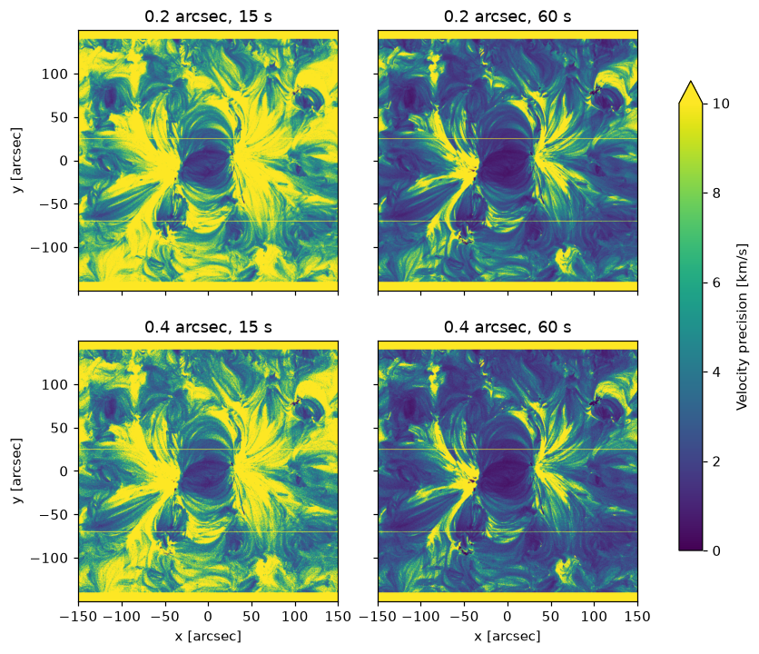
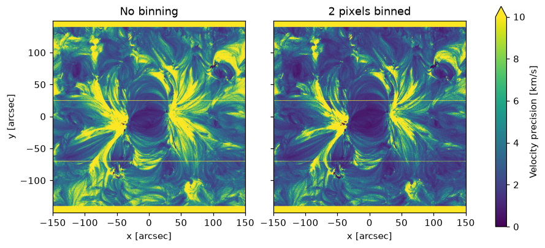
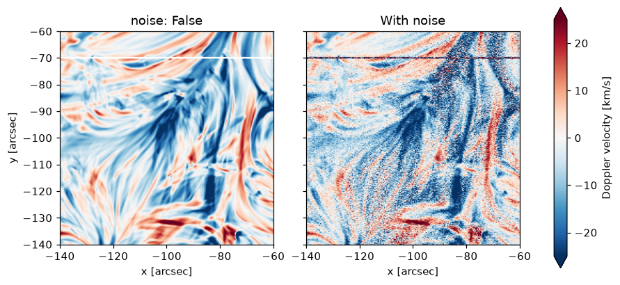

# Running a simulation

This is the second stage of a run. `eclipse` takes the spectra you made when you [synthesised them](index.md#how-eclipse-works), passes them through the telescope and detector, adds the noise, and fits the result as you would fit real data. The noise is random, so ECLIPSE repeats this many times (a Monte Carlo simulation). That gives the spread of the measured intensities, velocities and line widths, to compare with the known truth.

This page covers a run on a synthesis file. The same settings apply to [a single line of known intensity](uniform-intensity.md) and to a [time series](time-series.md).

## The command

Run the simulation with:

```bash
eclipse --config ./run/input/muram_ar_sweep.yaml
```

**Command-line options:**

- `--config`: the configuration file (required)
- `--debug`: when an error happens, open an IPython debugger where it happened in ECLIPSE's code (optional)

The results are written to `run/result/<config name>.h5`, named after the configuration file. [Analysing the results](analysis.md) shows how to read them.

## The configuration file

The configuration file is YAML. Its top level says which instrument to simulate, what to observe and how many Monte Carlo iterations to run. The instrument's settings go in four sections, `simulation`, `detector`, `telescope` and `filter`, and the fits' in `fitting`. The [configuration reference](configuration.md) lists every setting with its default, and [The instrument model](instrument-model.md) describes what they model.

A complete example, which observes the active region of the [worked example](worked-example.ipynb):

```yaml
# Input
instrument: SWC
synthesis_file: ./run/input/muram_ar_fe12.h5
reference_line: Fe12_195.1190

# Global settings (apply to all combinations)
n_iter: 10
ncpu: -1
fit_signals: dn
offchip_bin_slit: [1, 2]  # sweep no binning and 2-pixel off-chip binning

# Simulation parameters
# Any field listed as a list is swept over; all combinations are run.
simulation:
  slit_width: [0.2 arcsec, 0.4 arcsec]  # sweep over two slit widths
  expos: [15 s, 60 s]                   # sweep over two exposure times
  psf: True
  slit_mask: True

# Detector parameters
detector:
  ccd_temperature: -60 Celsius  # used to compute dark current via the CCD model

# Telescope parameters
telescope:
  microroughness_sigma: 0.3 nm  # RMS surface roughness

# Aluminium filter parameters (SWC only)
filter:
  al_thickness: 1485 angstrom
  oxide_thickness: 95 angstrom
  mesh_throughput: 0.8

# The fit, as in the worked example
fitting:
  start: rest
  constrain_positive_intensity: true
  components:
    - wavelength: 195.119 angstrom
      name: Fe XII 195.119
      velocity_limits: [-61.5 km/s, 61.5 km/s]
      width_limits: [0.0191 angstrom, 0.0510 angstrom]
    - wavelength: 195.179 angstrom
      name: Fe XII 195.179
      tie_center: 0
      tie_width: 0
```

**A setting given as a list of more than one value is swept**: ECLIPSE runs every combination of the swept values, as for `offchip_bin_slit`, `slit_width` and `expos` above, which make eight combinations. A list of one value is just that value. At the top level, only `offchip_bin_slit` is swept. The other lists there, such as the pinhole lists and a time series' files, are lists of things rather than sweeps, as are the fitting components. A few settings are lists themselves, and take one value: `telescope.psf_params`, `telescope.fiducial_centres` and `telescope.fiducial_lengths`. So does `telescope.psf_slit_width`, the slit `psf_params` was measured with.

Here are four of the eight combinations, with two pixels binned along the slit. Each map shows how precisely the velocity is measured in each pixel (its standard deviation over the ten iterations):



[Comparing combinations](analysis.md#comparing-combinations) gives these as numbers.

Any setting in the [configuration reference](configuration.md) can be added to its section in the same way. For example, to sweep over the detector's quantum efficiency:

```yaml
detector:
  ccd_temperature: -60 Celsius
  qe_euv: [0.5, 0.65, 0.76]   # sweep over three QE values
```

For recommended values, see [McKevitt et al. (2026), PASJ 78, 1524](https://academic.oup.com/pasj/article/78/4/1524/8731000).

!!! warning "Parameters must go inside their section"

    A setting written at the top level instead, such as `expos:` or `ccd_temperature:` directly under the document root, stops the run with an error naming the section it belongs in. Any other key ECLIPSE does not read, such as a misspelt name, stops the run in the same way.

## Off-chip slit binning

`offchip_bin_slit` adds together neighbouring pixels along the slit after read-out, so the binning is done on the ground rather than on the detector. Adding `n` pixels multiplies the signal by `n`, while the noise only grows as `sqrt(n)`. The signal to noise therefore goes up as `sqrt(n)`, at the cost of resolution along the slit.

```yaml
offchip_bin_slit: [1, 2, 4]   # swept like any other list
```

In the example above, with the 0.4 arcsec slit and 60 s exposures, binning two pixels takes the median precision from 4.3 to 3.0 km/s. Each pixel along the slit then covers 0.32 arcsec rather than 0.16:



## Turning the noise off

`noise: False` turns the noise off: every random draw in the detector is replaced by its mean. Every iteration is then the same, so one is enough:

```yaml
simulation:
  noise: False

n_iter: 1     # every iteration would be identical
```

Like any setting, it can be swept. Here is the fitted velocity in a quiet part of the [worked example](worked-example.ipynb)'s active region, in a 60 s exposure, from a run with `noise: [False, True]`:



## Multi-node MPI parallelisation

ECLIPSE can run as several MPI processes (ranks) on a SLURM cluster, started with `srun` or `mpirun` and `--ntasks-per-node`. It then shares the Monte Carlo iterations between the ranks, and collects the results on the first one. It detects MPI by itself, so nothing in the configuration changes. Without `mpi4py`, or with only one rank, it runs as a single process.

It needs `mpi4py` and Intel MPI (load it with `module load intel-mpi` before launching).

A submission script that runs one rank per node, with joblib using the cores within each rank:

```bash
#!/bin/bash
#SBATCH -N 5
#SBATCH --ntasks-per-node=1
#SBATCH --cpus-per-task=256
#SBATCH --time=1-00:00:00

module load intel-mpi
export I_MPI_PMI_LIBRARY=/opt/slurm/slurm-21-08-5-1/lib/libpmi.so
export I_MPI_PIN_DOMAIN=auto
export LOKY_MAX_CPU_COUNT=$SLURM_CPUS_PER_TASK
source /path/to/venv/bin/activate

srun --mpi=pmi2 --kill-on-bad-exit=1 eclipse --config ./run/input/my_run.yaml
```

MPI shares the iterations between the nodes, and joblib shares each rank's iterations between its cores. `--kill-on-bad-exit=1` stops every rank when one fails, rather than leaving the others waiting until the time limit. `I_MPI_PIN_DOMAIN=auto` lets each rank use its whole node, and `LOKY_MAX_CPU_COUNT` stops joblib starting more processes than that. Setting `ncpu` in the configuration is optional. Under MPI it is capped at `SLURM_CPUS_PER_TASK`, and `ncpu: -1` lets joblib find the CPUs it may use by itself.

