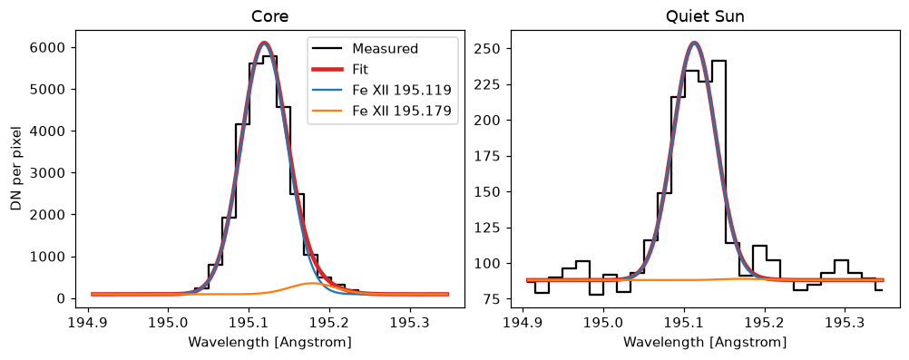
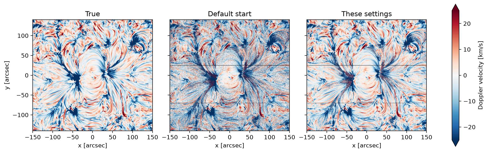

# Fitting the lines

Each spectrum is fitted with a Gaussian on a flat background, or several for a blend. The settings go in `fitting`.

## Several components

To fit a blend, list its lines under `components`:

```yaml
fitting:
  primary_component: 0
  constrain_positive_intensity: true
  components:
    - wavelength: 195.119 angstrom
      name: Fe XII 195.119
    - wavelength: 195.179 angstrom
      name: Fe XII 195.179
      tie_center: 0
      tie_width: 0
```

Give at least two components, or leave `components` out for one Gaussian. Each needs its rest `wavelength`, and can have:

- `tie_center: <i>`: the same velocity as component *i*
- `tie_width: <i>`: the same width as component *i*
- `amplitude_greater_than: <i>`: a larger amplitude than component *i*
- `name`: its name in the results (default: its rest wavelength)

The fits in one pixel of the active region's core:



The results hold every component; `primary_component` is the one given by default. See [Every component of a blend](../analyse/observation.md#every-component-of-a-blend).

## A faint blend

These follow [EISPAC](https://github.com/USNavalResearchLaboratory/eispac/blob/v0.99.4/eispac/data/templates/fe_12_195_119.2c.template.h5)'s constraints for Fe XII 195.119 and the faint 195.179:

```yaml
fitting:
  start: rest
  constrain_positive_intensity: true
  components:
    - wavelength: 195.119 angstrom
      velocity_limits: [-61.5 km/s, 61.5 km/s]
      width_limits: [0.0191 angstrom, 0.0510 angstrom]
    - wavelength: 195.179 angstrom
      tie_center: 0
      tie_width: 0
```

The true velocity, and that measured with the default start and with these settings:



## The fit

A fit that fails, or runs past `max_iter` (default 1000), is left out of the statistics, and the run says how many failed. `backend` is `scipy` (default) or `mpfit`. `save_iterations: true` keeps every iteration, making the results about `n_iter` times larger.

## Which signals are fitted

Both the DN and the photons reaching the detector are fitted. `fit_signals: dn` or `photon`, at the top level, fits one and saves time.
