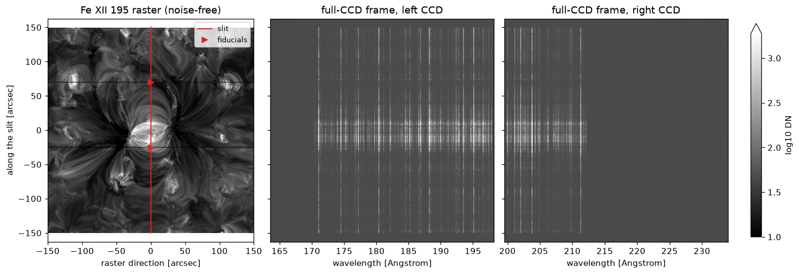

# Full-CCD frames

<div class="glance" markdown>
<div markdown>
**You need**

An [atmosphere file](../files/atmosphere.md), an [emission measure file](../files/emission-measure.md) or a [synthesis file](../files/synthesis.md)
</div>
<div markdown>
**You run**

`eclipse frame`
</div>
<div markdown>
**You get**

A [frame file](../files/frame.md) in `run/result/`
</div>
<div markdown>
**Next**

[Analysing a full-CCD frame](../analyse/frame.md)
</div>
</div>

A full-CCD frame is what the SW camera reads out at one slit position: both CCDs, with their prescan and overscan. It holds only the spectra in a synthesis file, so for a frame of the whole band ECLIPSE first synthesises every line in it.



This is the frame of the [worked example](../worked-example.ipynb)'s active region in a 60 s exposure, with the slit, in red on the left, through its core.

## From an MHD simulation { data-routes="mhd" }

Write a [run file](../run-files.md#a-full-ccd-frame) with an `atmosphere` and a `frame:` section, such as `slit_core.yaml`:

```yaml
instrument: SWC
atmosphere: muram_ar_1160000.h5

simulation:
  slit_width: 0.4 arcsec
  expos: 60 s
  psf: True
  slit_mask: True

frame:
  slit_position: 0 arcsec
  continuum: True
```

```bash
eclipse frame slit_core.yaml
```

This synthesises the band under the slit, then writes the frame to `run/result/slit_core_frame.h5`. The band's lines take a few hours to work out the first time, and are kept in a [band lines file](../files/band-lines.md), `run/input/band_lines.h5`, for later frames.

With an `emission_measure` in place of the `atmosphere`, the frame is made from a [DEM or VDEM](../emission/dem.md#a-full-ccd-frame) the same way.

## From your own spectra { data-routes="spectra" }

With a `synthesis_file` in place of the `atmosphere`, the frame holds that file's spectra as they are, from [another code](../emission/other-codes.md) or from ECLIPSE:

```yaml
instrument: SWC
synthesis_file: my_spectra.h5

simulation:
  expos: 60 s

frame:
  slit_position: 0 arcsec
```

## The band's spectrum { data-routes="mhd dem" }

`synthesise-spectra --band` synthesises every line between two wavelengths as one spectrum. `--image-x` keeps a strip of the image, as the whole image can take tens of gigabytes:

```bash
synthesise-spectra --atmosphere muram_ar_1160000.h5 --continuum \
  --band "169 Angstrom" "213.5 Angstrom" --image-x "-1 Mm" "1 Mm"
```

Set `--vel-lim` wide enough for the fastest flows.

## From Python

```python
import astropy.units as u
from eclipse import full_ccd_frame, write_full_frame

frame = full_ccd_frame("run/input/muram_ar_band.h5", slit_position=0 * u.arcsec,
                       exposure=60 * u.s, slit_width=0.4 * u.arcsec, slit_mask=True)
write_full_frame(frame, "frame.h5")
```

`slit_mask=True` blocks the light beyond the ends of the slit and behind its fiducials. `sim=Simulation(...)` takes the slit width, PSF and noise from a `Simulation` instead.

[Analysing a full-CCD frame](../analyse/frame.md) plots the frame's spectrum.

## How a frame differs from a simulated observation

| Effect | `eclipse` run | Full-CCD frame |
| --- | --- | --- |
| Pinholes in the filter | with `simulation.enable_pinholes` | not modelled |
| Visible stray light | with `simulation.vis_sl` | not modelled |
| Dark current | over the clear, the exposure and the read-out of its own rows alone, unless `simulation.readout_dark_current` is `False` | over the clear, the exposure and the read-out of every row |
| Wavelength of each pixel | a fixed step, `detector.wvl_res`, or with `simulation.focal_plane_dispersion` the focal plane's step where the line lands | the focal plane's dispersion, from 17.0 to 16.8 mA per row |
| The 1 mm gap between the CCDs | not modelled: a window sees an unbroken spectrum | no rows from 198.26 to 199.51 Angstrom |
| Rows outside the 170.0 to 212.3 Angstrom band | lit | dark |
| Smear without a shutter, and charge transfer | refused | modelled |
| Prescan and overscan | none | both |
