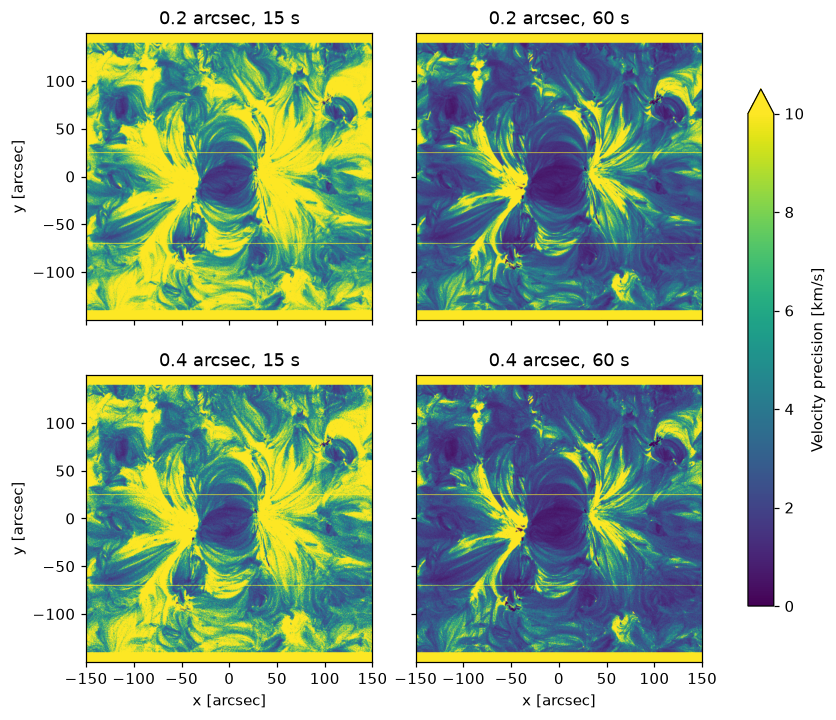
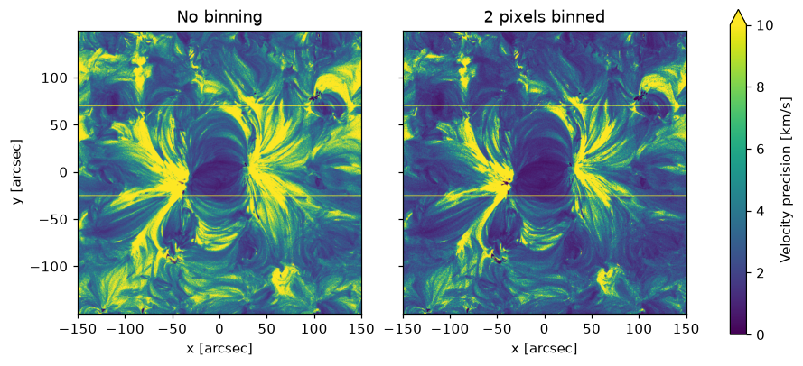
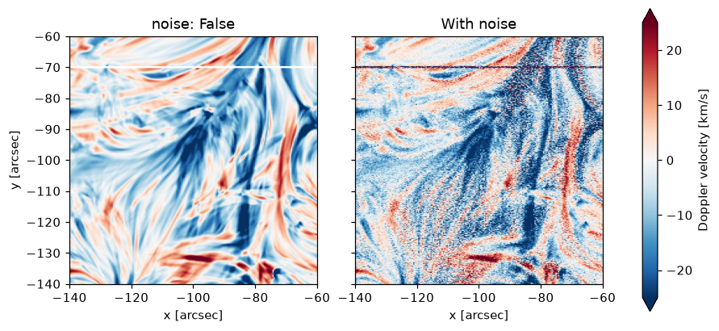

# Simulating an observation

<div class="glance" markdown>
<div markdown>
**You need**

A [synthesis file](../files/synthesis.md), or a [single intensity](../emission/single-intensity.md)
</div>
<div markdown>
**You run**

`eclipse run`, or `eclipse observe` for this step alone
</div>
<div markdown>
**You get**

A [results file](../files/results.md) in `run/result/`
</div>
<div markdown>
**Next**

[Analysing an observation](../analyse/observation.md)
</div>
</div>

ECLIPSE passes the spectra through the telescope and detector, adds noise, and fits the result as you would real data. It repeats this many times, a Monte Carlo simulation, to give the spread of the fitted intensities, velocities and widths.

## Running it

```bash
eclipse run ./run/input/muram_ar_sweep.yaml
```

The results go to `run/result/muram_ar_sweep.h5`.

## The run file

The top level names the instrument, the input and the iterations. The instrument goes in `simulation`, `detector`, `telescope` and `filter`, and the fit in `fitting`. [Run file settings](../reference/run-file-settings.md) lists every setting. This one observes the [worked example](../worked-example.ipynb)'s active region:

```yaml
instrument: SWC
synthesis_file: ./run/input/muram_ar_fe12.h5
reference_line: Fe12_195.1190
n_iter: 10
ncpu: -1
fit_signals: dn
offchip_bin_slit: [1, 2]               # swept

simulation:
  slit_width: [0.2 arcsec, 0.4 arcsec]  # swept
  expos: [15 s, 60 s]                   # swept
  psf: True
  slit_mask: True

detector:
  ccd_temperature: -60 Celsius

telescope:
  microroughness_sigma: 0.3 nm

filter:
  al_thickness: 1485 angstrom
  oxide_thickness: 95 angstrom
  mesh_throughput: 0.8

fitting:
  start: rest
  constrain_positive_intensity: true
  components:
    - wavelength: 195.119 angstrom
      name: Fe XII 195.119
      velocity_limits: [-61.5 km/s, 61.5 km/s]
      width_limits: [0.0191 angstrom, 0.0510 angstrom]
    - wavelength: 195.179 angstrom
      name: Fe XII 195.179
      tie_center: 0
      tie_width: 0
```

A list of values is swept: every combination is run, here eight. At the top level only `offchip_bin_slit` sweeps, and `psf_params`, `psf_slit_width`, `fiducial_centres` and `fiducial_lengths` take one value. Four of the combinations, as the velocity's standard deviation over the iterations:



A setting outside its section, or a misspelt key, stops the run with an error.

## Off-chip slit binning

`offchip_bin_slit` adds `n` pixels along the slit after read-out, raising the signal to noise by about `sqrt(n)` at the cost of resolution.

```yaml
offchip_bin_slit: [1, 2, 4]
```

With the 0.4 arcsec slit and 60 s, binning two takes the median precision from 4.0 to 2.8 km/s:



## Turning the noise off

`noise: False` replaces every random draw by its mean, so one iteration is enough:

```yaml
simulation:
  noise: False

n_iter: 1
```

The fitted velocity in a quiet part of the active region, with `noise: [False, True]`:


