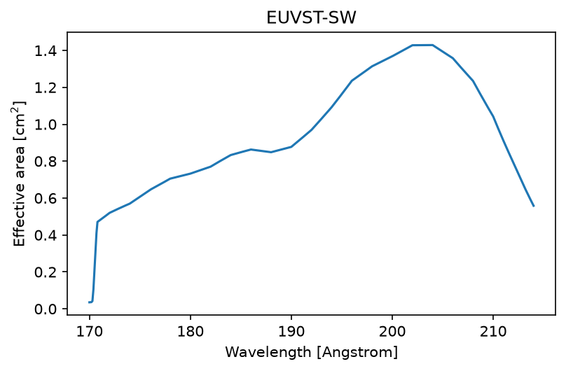
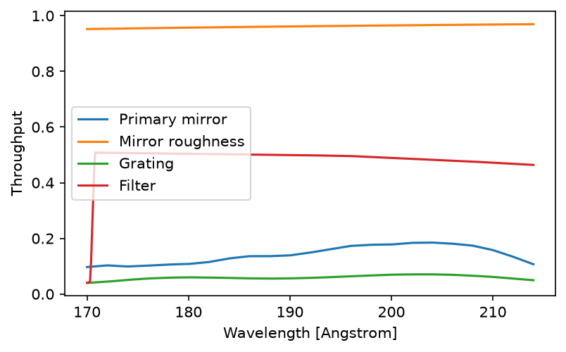

# From Python

Everything the commands do is in the `eclipse` package. This page shows the parts most used on their own; the [API reference](api.md) lists the rest.

## Running a run file

```python
import eclipse

[output] = eclipse.run("job.yaml", n_iter=10, simulation={"expos": "5 s"})
print(output.synthesis, output.results)
```

`eclipse.synthesise`, `eclipse.observe` and `eclipse.make_frame` do one step each.

## The instrument

`Telescope_EUVST` (with its `AluminiumFilter` as `filter`), `Detector_SWC` and `Simulation`, or `Telescope_EIS` and `Detector_EIS`, take the [run file settings](reference/run-file-settings.md) as keyword arguments, such as `Detector_SWC(ccd_temperature=-50 * u.deg_C)`.

### Effective area

```python
import astropy.units as u
import matplotlib.pyplot as plt
import numpy as np
from eclipse import Detector_SWC, Telescope_EUVST

telescope = Telescope_EUVST()
detector = Detector_SWC()
wavelength = np.linspace(170, 214, 441) * u.AA

effective_area = telescope.ea_and_throughput(wavelength) * detector.qe_euv

fig, ax = plt.subplots(figsize=(6, 3.5))
ax.plot(wavelength.value, effective_area.to_value(u.cm**2))
ax.set_xlabel("Wavelength [Angstrom]")
ax.set_ylabel("Effective area [cm$^2$]")
ax.set_title("EUVST-SW")
plt.show()
```



### The throughput of each part

```python
parts = {
    "Primary mirror": telescope.primary_mirror_efficiency(wavelength),
    "Mirror roughness": telescope.microroughness_efficiency(wavelength),
    "Grating": telescope.grating_efficiency(wavelength),
    "Filter": telescope.filter.total_throughput(wavelength),
}

fig, ax = plt.subplots(figsize=(6, 3.5))
for name, throughput in parts.items():
    ax.plot(wavelength.value, np.asarray(throughput), label=name)
ax.set_xlabel("Wavelength [Angstrom]")
ax.set_ylabel("Throughput")
ax.legend()
plt.show()
```



Another filter: `Telescope_EUVST(filter=AluminiumFilter(al_thickness=1200 * u.AA))`.

### The spectral PSF

```python
from eclipse import spectral_psf_fwhm

for slit in [0.2, 0.4, 0.8, 1.6] * u.arcsec:
    fwhm = spectral_psf_fwhm(telescope, detector, slit) * u.pix   # in detector pixels
    print(f"{slit}: {fwhm:.2f}, {(fwhm * detector.wvl_res).to(u.mAA):.1f}")
```

```text
0.2 arcsec: 2.54 pix, 42.9 mAngstrom
0.4 arcsec: 3.35 pix, 56.6 mAngstrom
0.8 arcsec: 5.49 pix, 92.8 mAngstrom
1.6 arcsec: 10.30 pix, 174.1 mAngstrom
```

### Dark current

```python
for temperature in [-70, -60, -50] * u.deg_C:
    print(f"{temperature}: {Detector_SWC(ccd_temperature=temperature).dark_current:.2f}")
```

```text
-70.0 deg_C: 0.43 electron / (pix s)
-60.0 deg_C: 2.15 electron / (pix s)
-50.0 deg_C: 9.50 electron / (pix s)
```

## Running one simulation

`monte_carlo` simulates the instrument on a cube of spectra on the detector's pixels, here a single line of known intensity:

```python
from eclipse import Simulation, create_uniform_intensity_cube, monte_carlo

simulation = Simulation(slit_width=0.2 * u.arcsec, expos=20 * u.s, psf=True)
cube = create_uniform_intensity_cube(5000 * u.erg / (u.s * u.cm**2 * u.sr), 195.119 * u.AA,
                                     20 * u.km / u.s, detector, simulation, tel=telescope)

first_dn, dn_stats, first_photon, photon_stats = monte_carlo(
    cube, simulation.expos, detector, telescope, simulation, n_iter=100, uniform_mode=True)

primary = dn_stats["components"][dn_stats["primary_component"]]
print(f"Velocity precision: {primary['velocity']['std'].squeeze():.2f}")
```

`dn_stats` and `photon_stats` hold the fits in DN and in photons: each component's intensity, velocity and width in each pixel, as the first fit and the mean and standard deviation over the iterations.

With `psf=True`, `create_uniform_intensity_cube` blurs the line before putting it on the pixels and sets `cube.meta["psf_applied"]`, so it is not blurred again. Make the cube again for each slit width or `spectral_psf`.

A cube of your own is blurred on its pixels, which biases the velocity of lines narrower than a pixel, with a warning. To avoid it, blur your scene first, by `spatial_psf_fwhm` and `spectral_psf_fwhm`, and set `meta["psf_applied"] = True`.

## Common random numbers

Giving two runs the same random numbers, [common random numbers](https://en.wikipedia.org/wiki/Variance_reduction#Common_Random_Numbers_%28CRN%29), makes most of their noise cancel when you compare them.

Runs of different brightness only stay in step if each count uses one random value, by [inverse-transform sampling](https://en.wikipedia.org/wiki/Inverse_transform_sampling). Two `monte_carlo` options do this:

`photon_shot_inverse_transform`, for runs that differ in photon flux, and `dark_current_inverse_transform`, for runs that differ in dark current.

```python
import numpy as np

np.random.seed(1234)   # the same value before each run being compared

first_dn, dn_stats, first_photon, photon_stats = monte_carlo(
    cube, simulation.expos, detector, telescope, simulation, n_iter=500, uniform_mode=True,
    photon_shot_inverse_transform=True,    # for runs differing in photon flux
    dark_current_inverse_transform=True,   # for runs differing in dark current
)
```

Both are off by default and slower. They are only in Python. With MPI, both runs need the same number of ranks.

## Other parts of the package

| To | Use | See |
| --- | --- | --- |
| Write and read atmosphere files | `Atmosphere`, `write_atmosphere`, `read_atmosphere` | [From an MHD simulation](emission/mhd.md), [Atmosphere files](files/atmosphere.md) |
| Synthesise lines from a DEM or VDEM | `EmissionMeasure`, `write_emission_measure`, `eclipse.synthesise` | [From a DEM or VDEM](emission/dem.md) |
| Write and read synthesis files | `Synthesis`, `SpectralLine`, `write_synthesis`, `load_synthesis`, `read_synthesis`, `read_synthesis_products` | [From another code](emission/other-codes.md), [Synthesis files](files/synthesis.md) |
| Analyse the results | `load_instrument_response_results`, `summary_table`, `get_results_for_combination`, `analyse_fit_statistics`, `create_sunpy_maps_from_combo` | [Analysing an observation](analyse/observation.md) |
