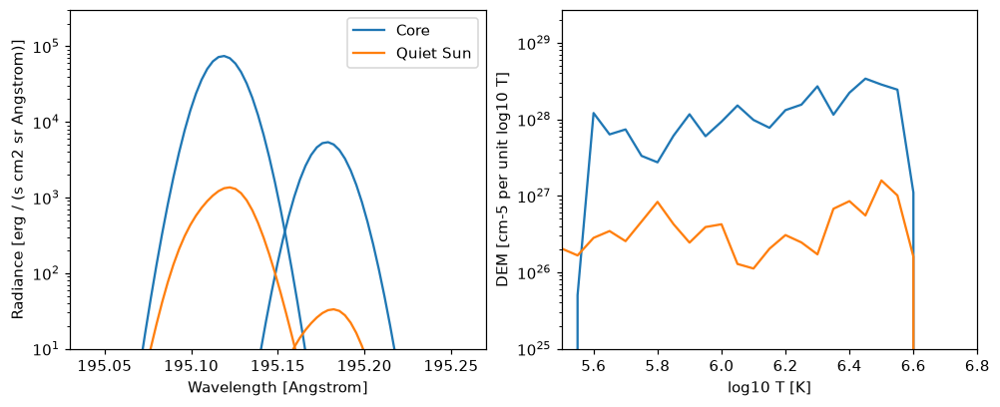
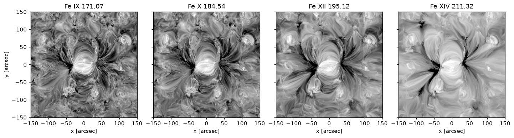

# Synthesising from an MHD simulation

`synthesise-spectra` turns a 3D MHD simulation into the spectra it emits, taking the plasma to be optically thin. For each pixel of the image, it adds up the emission measure of the cells along the line of sight by their temperature and velocity. It then multiplies that by each line's contribution function, G(T, n_e), which says how much the line emits at each temperature and density. The contribution functions come from the CHIANTI atomic database, through [fiasco](https://fiasco.readthedocs.io/).

The spectra are written to a synthesis file, which `eclipse` then observes (see [Running a simulation](instrument-response.md)).

## Atmosphere files

`synthesise-spectra` reads the simulation from an atmosphere file, an HDF5 file that you write from your simulation's output, and you pass it with `--atmosphere`:

```bash
synthesise-spectra --atmosphere atmosphere.h5 --lines Fe12_195.1190 --output-dir ./run/input
```

An atmosphere file holds the simulation's temperature, its mass density or electron density or both, the velocity along the line of sight, and the edges of its cells, each with its unit. It can also hold the snapshot's time. The cubes are indexed `[z, y, x]`, with z pointing up. The two axes that become the image must be evenly spaced, but the axis along the line of sight can have cells of different sizes. [Files](files.md#atmosphere-files) gives the full layout, for writing one with any HDF5 library, from Fortran, C, IDL or Julia.

### Writing a file from Python

```python
import astropy.units as u
import numpy as np
from eclipse import Atmosphere, write_atmosphere, edges_from_centres

atmosphere = Atmosphere(
    temperature=temperature * u.K,                # (nz, ny, nx)
    mass_density=density * u.g / u.cm**3,         # or electron_density=n_e / u.cm**3
    velocity_z=vz * u.km / u.s,                   # the component along the line of sight
    x_edges=np.arange(nx + 1) * 0.192 * u.Mm,     # an even grid
    y_edges=np.arange(ny + 1) * 0.192 * u.Mm,
    z_edges=edges_from_centres(z_centres * u.km), # an uneven one, from cell centres
    time=1250.0 * u.s,
    source="my simulation, snapshot 385",
)
write_atmosphere(atmosphere, "atmosphere.h5")
```

`Atmosphere` checks the shapes, units and edges when it is created. If your code only gives the cell centres, `edges_from_centres` puts each edge halfway between two neighbouring centres.

`read_atmosphere` reads a file back into an `Atmosphere`. To check what a file holds without loading the cubes, run

```bash
eclipse-atmosphere info atmosphere.h5
```

### Electron density

The contribution functions need the electron density. If your code calculates one, for example with non-equilibrium hydrogen ionisation, write it as `electron_density` and ECLIPSE will use it as it is.

If the file only has `mass_density`, ECLIPSE divides it by the mass per free electron. By default ECLIPSE works this out from the abundances chosen with `--abundance`, taking the plasma to be fully ionised. For coronal abundances it is about 1.16 atomic mass units per electron. You can set it yourself with `--mass-per-electron`.

The contribution functions are computed on a grid of densities, 0.3 apart in log10 n_e, that covers the densities of the plasma between 10^4 and 10^9 K. An atmosphere with a wide range of densities therefore takes longer and needs more memory.

### Cropping and downsampling

`--crop-x`, `--crop-y` and `--crop-z` are given in the coordinates of the file. A cell is kept if any part of it is inside the range. `--downsample N` keeps every N-th cell along each axis, and makes each one as big as the N cells it replaces, so the box keeps its size.

The synthesis file records the atmosphere file's path, its `source` and `time`, and the mass per electron that was used.

### Worked example: a MURaM active region

Most of the examples in these docs use a MURaM simulation of an active region in the quiet Sun. It covers 300 by 300 arcsec, as long as an EUVST-SW slit, so it fills the slit from end to end. It is on the UCL Research Data Repository, as [McKevitt (2026)](https://doi.org/10.5522/04/34806267). It is a test release, not for scientific use: the [worked example](worked-example.ipynb) says what is known to be off.

Each of the simulation's files holds one quantity in every cell, as 32-bit floats, ordered by y, then x, then height, with height changing fastest. The box is 1088 by 1088 cells of 200 km across, and 781 cells of 64 km in height, from 8 Mm below the photosphere to 42 Mm above it. The synthesis needs three of the files, 3.7 GB each:

- `eosT.1160000`: the temperature, in K;
- `result_prim_0.1160000`: the mass density, in g / cm3;
- `result_prim_1.1160000`: the vertical velocity, in cm / s, positive upward.

Download them into a folder called `muram_ar`:

```bash
mkdir muram_ar
curl -L -o muram_ar/eosT.1160000 https://ndownloader.figshare.com/files/70714761
curl -L -o muram_ar/result_prim_0.1160000 https://ndownloader.figshare.com/files/70714599
curl -L -o muram_ar/result_prim_1.1160000 https://ndownloader.figshare.com/files/70714614
```

Then write them to an atmosphere file. Only the heights above 1 Mm are kept, since the cooler layers below do not emit coronal lines, and leaving them out saves memory:

```python
from pathlib import Path

import astropy.units as u
import numpy as np
from eclipse import Atmosphere, write_atmosphere, edges_from_centres

SNAPSHOT = 1160000
FOLDER = Path("muram_ar")
NX = NY = 1088
NZ = 781
z = (np.arange(NZ) + 0.5) * 0.064 - 8.016   # height of each cell's centre above the photosphere, Mm
keep = z >= 1.0
x = (np.arange(NX) + 0.5 - NX / 2) * 0.2    # Mm


def variable(name):
    """One of the simulation's files, as (height, y, x), above 1 Mm."""
    cube = np.fromfile(FOLDER / f"{name}.{SNAPSHOT}", dtype="<f4").reshape(NY, NX, NZ)
    return np.ascontiguousarray(cube[:, :, keep].transpose(2, 0, 1))


atmosphere = Atmosphere(
    temperature=variable("eosT") * u.K,
    mass_density=variable("result_prim_0") * u.g / u.cm**3,
    velocity_z=variable("result_prim_1") * u.cm / u.s,
    x_edges=edges_from_centres(x * u.Mm), y_edges=edges_from_centres(x * u.Mm),
    z_edges=edges_from_centres(z[keep] * u.Mm),
    time=566510.0 * u.s,
    source=f"MURaM 300 arcsec active region, run 006, snapshot {SNAPSHOT}",
)
write_atmosphere(atmosphere, f"muram_ar_{SNAPSHOT}.h5")
```

`eclipse-atmosphere info muram_ar_1160000.h5` then shows what the file holds:

```text
muram_ar_1160000.h5
  Shape (nz, ny, nx): (640, 1088, 1088)
  x: -108.800 Mm to 108.800 Mm, cells of 0.2000 Mm
  y: -108.800 Mm to 108.800 Mm, cells of 0.2000 Mm
  z: 1.008 Mm to 41.968 Mm, cells of 0.0640 Mm
  Density: mass_density
  Velocities: z
  Time: 566510.000 s
  Source: MURaM 300 arcsec active region, run 006, snapshot 1160000
```

There is no electron density in these files, so ECLIPSE works it out from the mass density as described [above](#electron-density). The simulation's own equation of state gives 1.19 atomic mass units per electron in the corona, so `--mass-per-electron` is set to match. Fe XII 195.179 lies in the same window as 195.119, so both are synthesised:

```bash
synthesise-spectra --atmosphere muram_ar_1160000.h5 \
  --lines Fe12_195.1190 Fe12_195.1790 \
  --mass-per-electron 1.19 \
  --goft-temperature-chunk 20 --precision float32 \
  --output-dir ./run/input --output-name muram_ar_fe12.h5
```

`--goft-temperature-chunk` and `--precision float32` keep the memory down. This takes about 15 minutes and 330 GB of memory on 128 cores. [The output](#the-output) shows what it gives.

### Worked example: Bifrost quiet Sun

The [Hinode SDC Europe](https://sdc.uio.no/search/simulations) hosts snapshots of several MURaM and Bifrost simulations as FITS files, one file per variable. The values are in SI units, variables whose names start with `lg` are base-10 logarithms, and the heights of the cell centres are in the first FITS extension ([Carlsson et al. 2016](https://doi.org/10.1051/0004-6361/201527226), Sect. 5).

This example uses the enhanced-network run `en024048_hion` of [Carlsson et al. (2016)](https://doi.org/10.1051/0004-6361/201527226), at snapshot 385. It has an uneven z axis and carries its own electron density. Download the temperature, density, electron density and vertical velocity (480 MB each):

```bash
for variable in lgtg lgr lgne uz; do
  curl -O https://sdc.uio.no/vol/simulations/en024048_hion/atmos/BIFROST_en024048_hion_${variable}_385.fits
done
```

Then write them to an atmosphere file:

```python
import astropy.units as u
import numpy as np
from astropy.io import fits
from eclipse import Atmosphere, write_atmosphere, edges_from_centres

def variable(name, snapshot=385):
    with fits.open(f"BIFROST_en024048_hion_{name}_{snapshot}.fits") as hdul:
        return hdul[0].data, hdul[0].header, hdul[1].data  # cube (nz, ny, nx), header, z centres in Mm

lgtg, header, z = variable("lgtg")
lgr, _, _ = variable("lgr")
lgne, _, _ = variable("lgne")
uz, _, _ = variable("uz")

nz, ny, nx = lgtg.shape
x = (header["CRVAL1"] + (np.arange(nx) + 1 - header["CRPIX1"]) * header["CDELT1"]) * u.Mm
y = (header["CRVAL2"] + (np.arange(ny) + 1 - header["CRPIX2"]) * header["CDELT2"]) * u.Mm

atmosphere = Atmosphere(
    temperature=10.0 ** lgtg.astype(np.float64) * u.K,
    mass_density=10.0 ** lgr.astype(np.float64) * u.kg / u.m**3,
    electron_density=10.0 ** lgne.astype(np.float64) * u.m**-3,
    velocity_z=uz * u.m / u.s,
    x_edges=edges_from_centres(x), y_edges=edges_from_centres(y),
    z_edges=edges_from_centres(z * u.Mm),
    time=header["ELAPSED"] * u.s,
    source="Bifrost en024048_hion snapshot 385, Hinode SDC Europe",
)
write_atmosphere(atmosphere, "bifrost_385.h5")
```

The box starts 2.4 Mm below the surface, so `--crop-z "0 Mm" "20 Mm"` keeps the part that emits:

```bash
synthesise-spectra --atmosphere bifrost_385.h5 \
  --lines Fe09_171.0730 \
  --crop-z "0 Mm" "20 Mm" \
  --output-dir ./run/input
```

## Basic usage

```bash
# The shortest run
synthesise-spectra \
  --atmosphere muram_ar_1160000.h5 \
  --lines Fe12_195.1190 Fe12_195.1790 \
  --output-dir ./run/input

# The same, with more of the options, most at their defaults
synthesise-spectra \
  --atmosphere muram_ar_1160000.h5 \
  --lines Fe12_195.1190 Fe12_195.1790 \
  --abundance sun_coronal_2021_chianti \
  --n-workers 4 \
  --output-dir ./run/input \
  --output-name synthesised_spectra.h5 \
  --vel-res "5.0 km/s" \
  --vel-lim "300.0 km/s" \
  --integration-axis z \
  --crop-x "-50 Mm" "50 Mm" \
  --crop-y "-50 Mm" "50 Mm" \
  --crop-z "0 Mm" "20 Mm" \
  --downsample 1 \
  --precision float64 \
  --mass-per-electron 1.16

# Show all available options
synthesise-spectra --help
```

## Command line options

**Input and output:**

- `--atmosphere`: The [atmosphere file](#atmosphere-files) to synthesise from (required, except in the deprecated modes on [Older versions](older-versions.md))
- `--output-dir`: The directory to write the synthesis file to (default: `./run/input`)
- `--output-name`: The synthesis file's name (default: `synthesised_spectra.h5`)

**Lines and abundances:**

- `--lines`: The lines to synthesise, for example `--lines Fe12_195.1190 Fe12_195.1790`, named as in [Naming spectral lines](line-names.md) (required)
- `--abundance`: The CHIANTI abundance set (default: `sun_coronal_2021_chianti`)
- `--continuum`: Also synthesise the continuum under the lines' windows (default: off). Each group of overlapping windows gets one more entry in the synthesis file, named `continuum_<from>-<to>`, in Angstrom, and `eclipse` adds it to the window it falls in.
- `--n-workers`: How many processes compute the contribution functions, each taking one ion at a time, so there are never more than there are ions. `0`, the default, uses every CPU the job may use, as SLURM allocates them. `1` computes them one after another.
- `--hdf5-dbase-root`: The CHIANTI database for fiasco to read. The default is the one set in `~/.fiasco/fiascorc`. Use this to run with another CHIANTI version without changing that default.
- `--goft-temperature-chunk`: Compute the contribution functions for this many temperatures at a time, rather than the whole grid at once, to use less memory (default: the whole grid). With several ions and `--n-workers`, every worker needs that memory at the same time.

**Velocity grid:**

- `--vel-res`: The spacing of the velocity bins, with units (default: `"5.0 km/s"`). Each cell's emission is split between the two velocity bins either side of its velocity, and the two temperature bins either side of its temperature, so the emission's mean velocity is right at any spacing. A cell less than half a bin beyond the last bin goes into that bin.
- `--vel-lim`: How far the velocity grid reaches either side of zero, with units (default: `"300.0 km/s"`). Plasma faster than this is left out of the spectra, with a warning saying how much of the emission measure that is.

**Viewing direction:**

- `--integration-axis`: The axis to look along, and the side of the box to look from (default: `z`)
    - `z`: The view from above (+z), looking down through the height
    - `x`: The side view from +x, looking towards decreasing x; a flow towards +x is blueshifted
    - `y`: The side view from -y, looking towards increasing y; a flow towards -y is blueshifted

**Cropping, in the file's coordinates, with units:**

- `--crop-x`: The range of x to keep, for example `--crop-x "-50 Mm" "50 Mm"`
- `--crop-y`: The range of y to keep, for example `--crop-y "-50 Mm" "50 Mm"`
- `--crop-z`: The range of z to keep, for example `--crop-z "0 Mm" "20 Mm"`
- Leave out a crop option to keep the whole range along that axis

**Processing:**

- `--downsample`: Keep every N-th cell along each axis. N must divide every dimension of the atmosphere (default: `1`, no downsampling)
- `--precision`: `float32` or `float64` (default: `float64`)
- `--mass-per-electron`: The mass per free electron in atomic mass units, used to get the electron density from the mass density (default: worked out from `--abundance` for a fully ionised plasma, about 1.16 for coronal abundances; see [Electron density](#electron-density)). Not used if the atmosphere file has an electron density. `--mean-mol-wt` is the old name for this option, which defaulted to 1.29 up to ECLIPSE 0.11.0.

## Performance tips

- Use `--downsample 2` or `--downsample 4` for a first test
- Use `--precision float32` to use less memory, at some cost in accuracy
- Crop to the region you need, to save time
- Watch the memory: a full-resolution synthesis of a large box can need tens of GB
- Side views (`--integration-axis x`, `-x`, `y` or `+y`) need the atmosphere file to hold the velocity along that axis

## The output

`synthesise-spectra` writes a synthesis file. It holds each line's spectra over the image, which is what [`eclipse`](instrument-response.md) observes, and what the synthesis worked out on the way. [Files](files.md#synthesis-files) describes it, and how to read it in Python.

Here is how to read it. This gives the spectrum and the DEM of a pixel in the core of the [active region](#worked-example-a-muram-active-region), and of one in its quiet Sun:

```python
import astropy.units as u
import matplotlib.pyplot as plt
from eclipse import read_synthesis, read_synthesis_products

path = "run/input/muram_ar_fe12.h5"
synthesis = read_synthesis(path)
products = read_synthesis_products(path, keys=["dem_map", "logT_grid"])
unit = u.erg / (u.s * u.cm**2 * u.sr * u.AA)

fig, axes = plt.subplots(1, 2, figsize=(9, 3.6), layout="constrained")
for i, (name, (y, x)) in enumerate({"Core": (544, 544), "Quiet Sun": (150, 150)}.items()):
    for line, label in zip(synthesis.lines.values(), (name, None)):
        axes[0].plot(line.wavelength.to_value(u.AA), line.intensity[y, x].to_value(unit),
                     color=f"C{i}", label=label)
    axes[1].plot(products["logT_grid"], products["dem_map"][y, x], color=f"C{i}", label=name)
axes[0].set_xlim(195.03, 195.27)
axes[0].set_yscale("log")
axes[0].set_ylim(1e1, 3e5)
axes[0].set_xlabel("Wavelength [Angstrom]")
axes[0].set_ylabel("Radiance [erg / (s cm2 sr Angstrom)]")
axes[0].legend()
axes[1].set_xlim(5.5, 6.8)
axes[1].set_yscale("log")
axes[1].set_ylim(1e25, None)
axes[1].set_xlabel("log10 T [K]")
axes[1].set_ylabel("DEM [cm-5 per unit log10 T]")
plt.show()
```



The spectra hold the line as it leaves the Sun, before the instrument blurs it. Each line is on its own wavelengths, around its rest wavelength.

The same synthesis, run for three other lines, shows the region at different temperatures. Each map is the line's spectrum summed over wavelength. Fe IX and Fe X, which form near 0.8 and 1.1 MK, show fine threads, and Fe XIV, near 2 MK, smoother emission:


