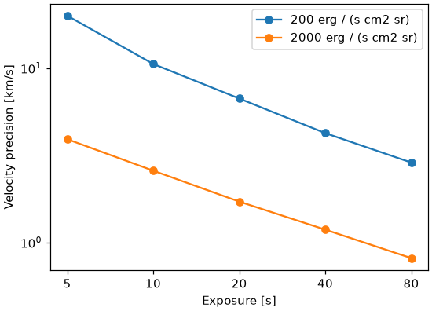

# A single line of known intensity

The simplest input is one spectral line of known total intensity. ECLIPSE makes a Gaussian line with that intensity and simulates the instrument observing it.

Unlike the [MHD](synthesis.md) and [DEM](dem-synthesis.md) routes, there is no separate synthesis step and no synthesis file. Instead you describe the line in the instrument's configuration file with `uniform_intensity`, and run `eclipse` on it directly. [Running a simulation](instrument-response.md) describes the rest of that file.

```yaml
instrument: SWC
uniform_intensity: 5000 erg / (s cm2 sr)   # units are required
rest_wavelength: 195.119 AA                # default 195.119 AA
thermal_width: 20 km/s                     # the line's width, as a 1-sigma velocity; default 20 km/s

n_iter: 500
ncpu: -1

simulation:
  slit_width: [0.2 arcsec, 0.4 arcsec]
  expos: [5 s, 20 s, 80 s, 320 s]
  psf: True
```

```bash
eclipse --config configs/uniform.yaml
```

The line fills a single pixel on the sky, and is laid onto the detector's wavelength pixels directly.

## Off-chip binning

[`offchip_bin_slit`](instrument-response.md#off-chip-slit-binning) works here too. ECLIPSE puts the same line in as many pixels along the slit as are binned together, each with its own noise, and adds them up as the binning would:

```yaml
uniform_intensity: 5000 erg / (s cm2 sr)
offchip_bin_slit: [1, 2, 4]   # 1, 2 and 4 slit pixels binned on the ground
```

## The point spread function

With `psf: True`, the line is blurred by the instrument's spectral response before it is laid onto the wavelength pixels, as a synthesised spectrum is; see [The point spread function](instrument-model.md#the-point-spread-function). The line is the same all along the slit, so it is not blurred along the slit. Its photons are counted at their own wavelengths, then blurred and summed over each pixel, so each pixel holds the radiance that gives its photons at the pixel's wavelength. The effective area and the photon energy change slowly across the line, so the pixels add up to the line's intensity closely but not exactly. For the same reason, a line several pixels wide is fitted a few hundredths of a km/s from its rest wavelength without noise, to the red for Fe XII 195.119.

## Why use it

The input intensity is known exactly and is the same everywhere, so all of the scatter in the fitted results comes from the instrument. That makes it useful for building an uncertainty budget, such as carrying a line's intensity precision through to the uncertainty on a FIP bias.

It is also much faster than the other routes, because there is no contribution function to compute. You can sweep quickly over many instrument settings and exposure times. This sweep took about three minutes for each intensity: Fe XII 195.119 with a width of 20 km/s, at the median intensity over the [worked example](worked-example.ipynb)'s simulation, 200 erg / (s cm2 sr), and ten times that, with the 0.4 arcsec slit and the PSF.


